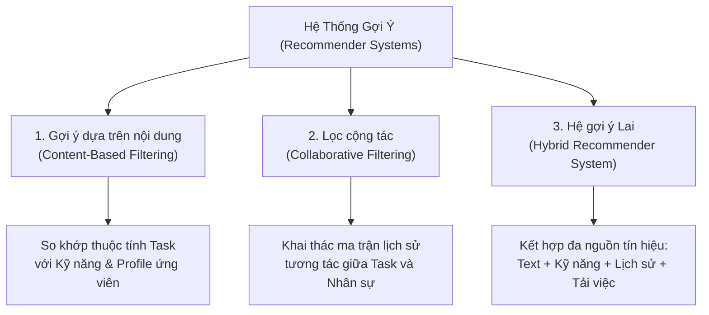
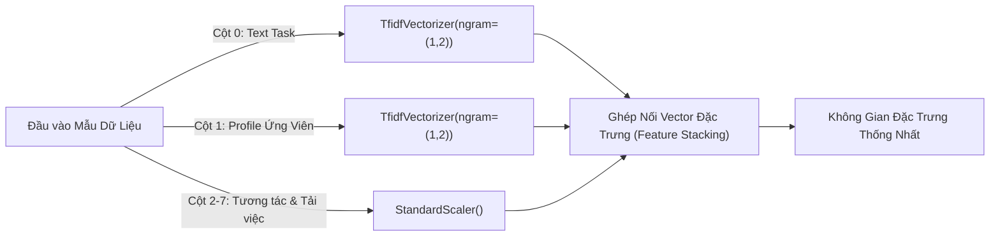
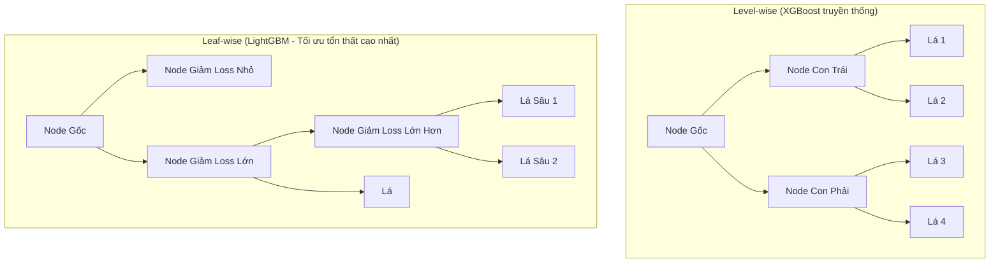
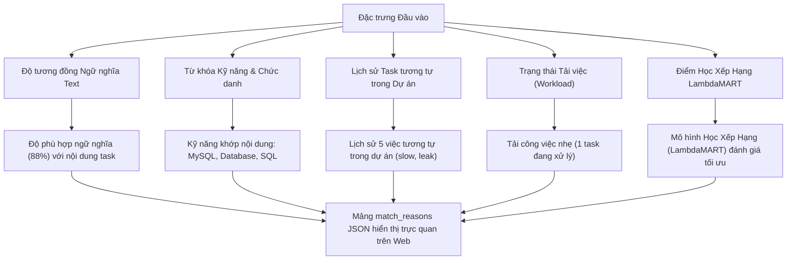

# CHƯƠNG 2: CƠ SỞ LÝ THUYẾT VÀ CÁC CÔNG NGHỆ NỀN TẢNG
## (THEORETICAL FOUNDATIONS & BACKGROUND TECHNOLOGIES)

---

## 2.1. Tổng quan về Hệ thống Gợi ý (Recommender Systems)

### 2.1.1. Khái niệm và Vai trò
Hệ thống gợi ý (Recommender System - RecSys) là một phân ngành quan trọng của Trí tuệ Nhân tạo và Khoa học Dữ liệu, có nhiệm vụ ước lượng mức độ quan tâm, độ phù hợp hoặc sở thích của người dùng đối với một tập hợp các thực thể (vật phẩm, nội dung, hoặc công việc) dựa trên dữ liệu lịch sử và ngữ cảnh hiện tại.

Trong bối cảnh quản lý dự án công nghệ thông tin và phát triển phần mềm, hệ thống gợi ý đóng vai trò là một trợ lý thông minh giúp:
- **Tự động hóa phân công công việc (Task Assignment / Bug Triage):** Giảm thiểu thời gian và công sức của Project Manager / Tech Lead trong việc đọc, phân loại và tìm người xử lý.
- **Tối ưu hóa nguồn lực nhân sự:** Phân bổ đúng người đúng việc dựa trên kỹ năng chuyên môn, kinh nghiệm thực chiến và dung lượng tải công việc hiện tại.
- **Giảm thiểu sai sót và hiện tượng chuyển giao lòng vòng (Bug-Tossing):** Giúp công việc đến tay người có năng lực thực hiện ngay từ lần đầu tiên.

### 2.1.2. Phân loại các hướng tiếp cận chính

Trong lý thuyết Hệ thống Gợi ý, có 3 phương pháp tiếp cận kinh điển:

#### a. Gợi ý dựa trên nội dung (Content-Based Filtering - CBF)
- **Nguyên lý:** Phân tích các thuộc tính văn bản và đặc trưng của công việc (tên task, mô tả, nhãn, component) rồi so sánh độ tương đồng với hồ sơ năng lực của nhân sự (kỹ năng, chức danh chuyên môn).
- **Ưu điểm:** Khả năng giải thích cao (Explainable); không gặp vấn đề "Khởi đầu lạnh cho nhân sự mới" (New User Cold-Start) nếu nhân sự đã khai báo kỹ năng trong hồ sơ.
- **Hạn chế:** Không học được từ phản hồi cộng tác trong quá khứ; dễ gợi ý các ứng viên tương tự lặp đi lặp lại mà không nắm được ai làm việc đó hiệu quả hơn.

#### b. Lọc cộng tác (Collaborative Filtering - CF)
- **Nguyên lý:** Dựa trên ma trận tương tác lịch sử phân công $R \in \mathbb{R}^{M \times N}$ giữa $M$ công việc và $N$ lập trình viên. Những nhân sự có lịch sử hoàn thành các nhóm công việc tương tự nhau sẽ được xếp vào cùng một nhóm tương quan.
- **Ưu điểm:** Tự động phát hiện các mẫu ẩn (latent patterns) mà không cần bóc tách từ ngữ văn bản chi tiết.
- **Hạn chế:** Bị ảnh hưởng nặng nề bởi bài toán **Khởi đầu lạnh (Cold-Start)** khi dự án mới khởi tạo hoặc khi một task hoàn toàn mới xuất hiện mà chưa có dữ liệu lịch sử tương tự.

#### c. Hệ gợi ý Lai (Hybrid Recommender System)
- **Nguyên lý:** Kết hợp đồng thời thế mạnh của cả Content-Based Filtering, Lịch sử cộng tác (Collaborative Context), và Ngữ cảnh động (Dynamic Context như tải việc hiện tại).
- **Lý do lựa chọn cho TaskPilot:** Bài toán phân công công việc thực tế đòi hỏi **tính toàn diện**: vừa phải đọc hiểu nội dung kỹ thuật của task (Content), vừa phải tham chiếu lịch sử đã từng giải quyết task tương tự trong dự án (Collaborative), vừa phải kiểm tra người đó có đang rảnh hay quá tải không (Workload Context).

---

## 2.2. Định nghĩa Bài toán Phân công Công việc Tự động (Problem Formulation)

### 2.2.1. Phát biểu bài toán
Trong phát triển phần mềm, phân công công việc (Task / Bug Assignment) là bài toán ra quyết định nhằm tìm ra nhân sự có năng lực giải quyết công việc tốt nhất trong tập hợp thành viên của dự án. 

Về mặt toán học, bài toán được mô hình hóa dưới dạng bài toán **Xếp hạng có ràng buộc (Constrained Ranking Problem)**:

- **Đầu vào (Input):**
  1. **Thông tin công việc cần phân công ($t$):** Được biểu diễn bởi bộ thuộc tính văn bản và siêu dữ liệu:
     $$t = \left( T_{\text{text}}, T_{\text{meta}} \right)$$
     Trong đó:
     - $T_{\text{text}} = \{\text{Summary}, \text{Description}\}$ là nội dung mô tả kỹ thuật của công việc.
     - $T_{\text{meta}} = \{\text{Type}, \text{Priority}, \text{Components}, \text{Labels}\}$ là siêu dữ liệu phân loại.
  2. **Tập hợp ứng viên trong dự án ($\mathcal{U}$):** Gồm $K$ thành viên $\mathcal{U} = \{u_1, u_2, \dots, u_K\}$, trong đó mỗi ứng viên $u_i$ được biểu diễn bởi bộ ba thông tin:
     $$u_i = \left( \mathcal{S}_i, \mathcal{H}_i, w_i \right)$$
     - $\mathcal{S}_i$: Hồ sơ kỹ năng và chức danh chuyên môn (Skills & Job Title).
     - $\mathcal{H}_i$: Lịch sử các công việc đã giải quyết thành công trong dự án (Project History).
     - $w_i \in \mathbb{N}$: Số lượng công việc hiện đang đảm nhận dở dang (Active Workload).

- **Đầu ra (Output):**
  Danh sách xếp hạng gồm $k$ ứng viên tối ưu nhất ($k \le K$):
  $$\mathcal{R}(t, \mathcal{U}) = \left[ u_{(1)}, u_{(2)}, \dots, u_{(k)} \right]$$
  sao cho điểm số phù hợp giảm dần: $\text{Score}(t, u_{(1)}) \ge \text{Score}(t, u_{(2)}) \ge \dots \ge \text{Score}(t, u_{(k)})$.

### 2.2.2. Mục tiêu tối ưu và Các ràng buộc nghiệp vụ
Mục tiêu của bài toán là cực đại hóa hàm đánh giá độ phù hợp tổng thể giữa công việc $t$ và ứng viên $u$:

$$\max_{u \in \mathcal{U}} \text{Score}(t, u) = f\left( t, \mathcal{S}_u, \mathcal{H}_u, w_u \right)$$

Hàm mục tiêu phải đồng thời thỏa mãn **2 ràng buộc cốt lõi**:

1. **Ràng buộc năng lực chuyên môn (Expertise Constraint - Điều kiện cần):**
   Ứng viên phải có năng lực và kỹ năng phù hợp với yêu cầu nghiệp vụ của công việc:
   $$\text{Competence}(t, \mathcal{S}_u, \mathcal{H}_u) > 0$$
   *Ý nghĩa:* Nghiên cứu thực nghiệm (*Anvik et al., ICSE; Jeong et al., FSE*) chỉ ra rằng nếu giao việc cho nhân sự không có kỹ năng, công việc sẽ bị chậm trễ do hiện tượng chuyển giao lòng vòng (**Bug-Tossing**). Do đó, năng lực chuyên môn là điều kiện tiên quyết bắt buộc.

2. **Ràng buộc cân bằng tải (Workload Balancing Constraint - Điều kiện điều phối):**
   Tránh phân công dồn dập vào nhân sự đang bị quá tải công việc:
   $$\text{Workload Penalty: } w_u \le W_{\text{max}}$$
   *Ý nghĩa:* Khi nhiều ứng viên cùng thỏa mãn điều kiện năng lực chuyên môn, hệ thống ưu tiên phân công cho nhân sự có số lượng việc dở dang ít hơn ($w_u$ nhỏ), giúp tránh nút thắt cổ chai (bottleneck) và duy trì sự cân bằng tải trong dự án.

---

## 2.3. Kỹ thuật Xử lý Ngôn ngữ Tự nhiên & Biểu diễn Đặc trưng (NLP & Feature Engineering)

### 2.3.1. Tiền xử lý văn bản (Text Preprocessing)
Văn bản mô tả công việc phần mềm chứa nhiều thuật ngữ hỗn hợp (tiếng Anh, tiếng Việt, mã nguồn, tên bảng CSDL, tên thư viện). Quy trình tiền xử lý bao gồm:
1. **Làm sạch & Tách từ (Tokenization):** Sử dụng biểu thức chính quy `r"(?u)\b[\w\-\.]+\b"` để bảo tồn các từ ghép kỹ thuật như `ci-cd`, `vue.js`, `jwt-token`.
2. **Loại bỏ từ dừng chung (General Stopwords Removal):** Loại bỏ các hư từ không mang nghĩa phân loại (`the`, `and`, `should`, `file`, `this`, `that`).
3. **Mở rộng $N$-gram (Unigram & Bigram):**
   - Đơn từ (Unigram): `mysql`, `leak`, `memory`.
   - Cặp từ (Bigram): `memory leak`, `slow query`, `refresh token`, `kanban modal`. Cặp từ giúp mô hình nắm bắt chính xác ngữ nghĩa kỹ thuật mà các từ đơn lẻ không biểu đạt hết.

### 2.3.2. Kỹ thuật TF-IDF và Sublinear TF Scaling
Thuật toán **TF-IDF (Term Frequency - Inverse Document Frequency)** phản ánh mức độ quan trọng của một từ $t$ trong một tài liệu $d$ thuộc tập văn bản $D$:

$$\text{TF-IDF}(t, d, D) = \text{TF}(t, d) \times \text{IDF}(t, D)$$

Trong đó:
- **Tần suất xuất hiện (Term Frequency - TF):** Để tránh việc một từ lặp lại quá nhiều lần lấn át các từ khóa khác, TaskPilot sử dụng **Sublinear TF Scaling**:
  $$\text{TF}_{\text{sublinear}}(t, d) = \begin{cases} 1 + \log(f_{t, d}) & \text{nếu } f_{t, d} > 0 \\ 0 & \text{ngược lại} \end{cases}$$
- **Nghịch đảo tần suất tài liệu (Inverse Document Frequency - IDF):** Đánh giá độ hiếm của từ khóa trong toàn bộ tập văn bản:
  $$\text{IDF}(t, D) = \log\left(\frac{1 + |D|}{1 + |\{d \in D : t \in d\}|}\right) + 1$$
- **Chuẩn hóa vector (L2-Normalization):** Đảm bảo độ dài văn bản ngắn hay dài không làm sai lệch độ tương đồng:
  $$\mathbf{v}_{\text{norm}} = \frac{\mathbf{v}}{\|\mathbf{v}\|_2}$$

### 2.3.3. Chuẩn hóa đặc trưng số bằng `StandardScaler`
Các biến số định lượng phản ánh tương tác giữa ứng viên và công việc có các đơn vị và dải đo khác nhau:
- $x_1$: Số kỹ năng khớp trực tiếp ($0 \dots 5$)
- $x_2$: Số từ khóa domain chuyên môn ($0 \dots 4$)
- $x_3$: Số từ khóa lịch sử trùng lặp ($0 \dots 10$)
- $x_4$: Tổng số task đã hoàn thành trong dự án ($0 \dots 50$)
- $x_5$: Số task cùng loại (`Bug`, `Improvement`) ($0 \dots 20$)
- $x_6$: Tải công việc hiện tại - `active_tasks_count` ($0 \dots 15$)

Để tránh tình trạng các đặc trưng có giá trị lớn lấn át các đặc trưng có giá trị nhỏ, kỹ thuật **Z-Score Normalization (`StandardScaler`)** được áp dụng:

$$z = \frac{x - \mu}{\sigma}$$

Trong đó $\mu$ là giá trị trung bình (mean) và $\sigma$ là độ lệch chuẩn (standard deviation).

### 2.3.4. Kiến trúc tiền xử lý đa luồng `ColumnTransformer`
Trong thư viện Scikit-Learn, `ColumnTransformer` cho phép tích hợp song song các phép biến đổi không đồng nhất trên các cột dữ liệu khác nhau:

---

## 2.4. Kỹ thuật Học Xếp Hạng (Learning to Rank - LTR)

### 2.4.1. Sự khác biệt giữa Phân Loại và Học Xếp Hạng
Các phương pháp học máy truyền thống thường coi bài toán gợi ý là một bài toán **Phân loại nhị phân (Binary Classification)**: dự đoán xem ứng viên $u$ có phù hợp với task $t$ hay không ($y \in \{0, 1\}$).

Tuy nhiên, cách tiếp cận này có nhược điểm chí mạng:
1. **Độc lập cục bộ:** Mô hình đánh giá từng ứng viên riêng rẽ mà không biết ai đang cạnh tranh với ai trong cùng một task.
2. **Không tối ưu danh sách Top-$k$:** Trong thực tế, quản lý dự án không quan tâm xác suất tuyệt đối của từng người là bao nhiêu phần trăm, mà chỉ quan tâm: **"Trong số những người hiện có của dự án này, ai là người số 1, ai số 2, ai số 3?"**.

**Học Xếp Hạng (Learning to Rank - LTR)** là kỹ thuật tối ưu hóa trực tiếp thứ tự ưu tiên của toàn bộ danh sách ứng viên (Listwise Ranking) cho từng nhóm truy vấn (Query Group).

| Tiêu chí | Phân loại nhị phân (Classification) | Học Xếp Hạng (Learning to Rank) |
| :--- | :--- | :--- |
| **Đơn vị mẫu dữ liệu** | Từng cặp độc lập $(Task, User) \to \{0, 1\}$ | Một nhóm truy vấn $Task \to [User_1, User_2, \dots, User_K]$ |
| **Hàm mất mát (Loss Function)** | Log-Loss / Cross-Entropy | **NDCG Loss (LambdaMART)** |
| **Mức độ tương quan** | 0 hoặc 1 (Nhị phân) | Đa cấp độ: Grade 3 (Tối ưu), 2 (Tốt), 1 (Kém), 0 (Không phù hợp) |
| **Khả năng giải quyết Trade-off** | Phải viết luật `if/else` thủ công | **Mô hình tự động học tương tác phi tuyến từ dữ liệu** |

### 2.4.2. Thuật toán Cây quyết định Tăng cường Độ dốc & Thư viện LightGBM
**LightGBM (Light Gradient Boosting Machine)** do Microsoft Research phát triển là một trong những framework học máy trên dữ liệu dạng bảng (tabular/features) mạnh nhất hiện nay:
- **Phân nhánh theo lá (Leaf-wise Tree Growth):** Khác với XGBoost phân nhánh theo tầng (Level-wise), LightGBM chọn chiếc lá có độ giảm tổn thất (Loss reduction) lớn nhất để phân nhánh, giúp đạt độ chính xác cao hơn với cùng số lượng lá.
- **Nhóm bin giá trị (Histogram-based Algorithm):** Gom các giá trị số liên tục vào các bin rời rạc (256 bins), giảm chi phí tính toán từ $\mathcal{O}(\text{data} \times \text{features})$ xuống $\mathcal{O}(\text{bin} \times \text{features})$, giúp tốc độ huấn luyện nhanh hơn 10–20 lần.
- **Tiêu thụ tài nguyên tối thiểu:** Gói wheel của LightGBM chỉ nặng ~3.5MB, chạy 100% Offline trên CPU mà không đòi hỏi GPU hay các bộ cài CUDA cồng kềnh.

### 2.4.3. Thuật toán LambdaMART & Độ đo NDCG (Normalized Discounted Cumulative Gain)
**LambdaMART** là thuật toán Học Xếp Hạng tiêu chuẩn công nghiệp (State-of-the-Art), là sự kết hợp giữa **MART (Multiple Additive Regression Trees)** và giải thuật tính độ dốc **LambdaRank**.

#### a. Độ đo NDCG@k (Normalized Discounted Cumulative Gain)
Để đo lường chất lượng của một danh sách gợi ý $k$ người, ta tính:
1. **Độ lợi tích lũy có chiết khấu (DCG@k):** Các ứng viên phù hợp xếp ở vị trí càng cao thì điểm thưởng càng lớn, xếp ở vị trí thấp sẽ bị chiết khấu bởi hàm $\log_2(\text{vị trí} + 1)$:
   $$\text{DCG}@k = \sum_{i=1}^k \frac{2^{y_i} - 1}{\log_2(i + 1)}$$
   Trong đó $y_i \in \{0, 1, 2, 3\}$ là cấp độ liên quan (Relevance Grade) của người ở vị trí thứ $i$.
2. **Độ đo NDCG@k:** Chuẩn hóa DCG@k về đoạn $[0, 1]$ bằng cách chia cho giá trị DCG lý tưởng nhất (IDCG@k):
   $$\text{NDCG}@k = \frac{\text{DCG}@k}{\text{IDCG}@k} \in [0.0, 1.0]$$

#### b. Nguyên lý tính Gradient $\lambda$ trong LambdaMART
Vì hàm NDCG@k là hàm bước nhảy không liên tục (rời rạc theo vị trí xếp hạng), ta không thể lấy đạo hàm trực tiếp. LambdaMART giải quyết vấn đề này bằng cách tính **vector giả gradient $\lambda_{ij}$** khi hoán đổi vị trí của hai ứng viên $u_i$ và $u_j$:

$$\lambda_{ij} = \frac{-1}{1 + e^{s_i - s_j}} |\Delta \text{NDCG}|$$

Trong đó:
- $s_i, s_j$ là điểm dự đoán của mô hình cho ứng viên $i$ và $j$.
- $|\Delta \text{NDCG}|$ là độ biến thiên của chỉ số NDCG nếu hoán đổi vị trí của ứng viên $i$ và ứng viên $j$.
- Các cây quyết định trong LightGBM sẽ liên tục phân nhánh để tối thiểu hóa sai lệch của vector $\lambda$, trực tiếp đẩy người có độ phù hợp cao nhất và ít bị nghẽn tải lên đầu bảng.

---

## 2.5. Trí tuệ Nhân tạo Giải thích được (Explainable AI - XAI)

### 2.5.1. Định nghĩa và Tầm quan trọng
Trong bài toán quản trị nhân sự và điều phối dự án, AI đóng vai trò **hỗ trợ ra quyết định (Decision Support System)** chứ không thay thế hoàn toàn con người. Một quyết định phân công nếu chỉ đưa ra con số xác suất trơ trọi (ví dụ: `85%`) sẽ dẫn đến các vấn đề:
- Người quản lý không hiểu cơ sở khoa học đằng sau con số đó.
- Lập trình viên nhận việc cảm thấy thiếu thuyết phục hoặc bị áp đặt.

Do đó, hệ thống cần áp dụng nguyên lý **Explainable AI (XAI)** để tạo ra sự tin tưởng (Trustworthy AI) và tính minh bạch.

### 2.5.2. Cơ chế sinh giải thích (Transparent Match Reasons)
TaskPilot sử dụng cơ chế bóc tách động đa nhân tố (Multi-Factor Attribution) để ánh xạ các đặc trưng có trọng số cao nhất thành các lý do tự nhiên bằng tiếng Việt:

---

## 2.6. Các Độ Đo Đánh Giá Hiệu Năng Hệ Thống (Evaluation Metrics)

Để đánh giá toàn diện mô hình cả về mặt học thuật lẫn tính sẵn sàng trong môi trường thực tế, 4 độ đo cốt lõi được sử dụng:

### 2.6.1. Độ chính xác Top-$k$ (Hit@k)
Tỷ lệ các công việc mà người thực tế giải quyết ($u^*$) nằm trong danh sách $k$ người được AI gợi ý đầu tiên ($k \in \{1, 3, 5\}$):

$$\text{Hit}@k = \frac{1}{|Q|} \sum_{i=1}^{|Q|} \mathbb{I}(u_i^* \in \text{Top-}k(i))$$

Trong đó $\mathbb{I}(\cdot)$ là hàm chỉ báo (bằng 1 nếu đúng, bằng 0 nếu sai).

### 2.6.2. Thứ hạng nghịch đảo trung bình (MRR - Mean Reciprocal Rank)
Đánh giá chất lượng của vị trí xuất hiện đầu tiên của người phù hợp. Nếu người thực tế giải quyết nằm ở vị trí thứ nhất thì nhận điểm $1$, ở vị trí thứ hai thì nhận điểm $1/2$, vị trí thứ ba nhận $1/3$:

$$\text{MRR} = \frac{1}{|Q|} \sum_{i=1}^{|Q|} \frac{1}{\text{rank}_i}$$

### 2.6.3. Độ công bằng và Cân bằng Tải việc (Workload Fairness Rate)
Tỷ lệ các trường hợp kiểm thử mà trong đó nhân sự đang quá tải ($\ge 5$ task) không bị xếp đè lên nhân sự có chuyên môn tương đương nhưng đang rảnh việc:

$$\text{Fairness Rate} = \frac{\text{Số lần nhân sự quá tải bị giáng hạng đúng quy định}}{\text{Tổng số kịch bản kiểm thử quá tải}}$$

### 2.6.4. Độ trễ suy luận (Inference Latency)
Thời gian thực thi của mô hình để phân tích và trả về danh sách gợi ý cho một công việc:
$$\text{Latency} = t_{\text{response}} - t_{\text{request}} \quad (\text{mili-giây - ms})$$
Hệ thống đạt tiêu chuẩn môi trường sản xuất (Production-ready) khi độ trễ suy luận $\le 15\text{ ms}$, đảm bảo trải nghiệm tương tác mượt mà tức thì cho người dùng trên giao diện Web.

---

## 2.7. Tóm tắt Chương 2
Chương 2 đã thiết lập một nền tảng khoa học vững chắc cho hệ sinh thái AI của TaskPilot:
1. Xác định mô hình **Hệ gợi ý Lai (Hybrid Recommender System)** là giải pháp tối ưu cho bài toán phân công công việc phần mềm.
2. Ứng dụng các kỹ thuật xử lý ngôn ngữ tự nhiên tiên tiến (**Sublinear TF-IDF**, **$N$-gram**, **ColumnTransformer**) để trích xuất ngữ nghĩa công việc.
3. Chuyển đổi bài toán từ phân loại truyền thống sang **Học Xếp Hạng (Learning to Rank)** với thuật toán **LambdaMART (LightGBM)**, giải quyết tự động bài toán đánh đổi phi tuyến giữa Kỹ năng chuyên môn và Tải công việc.
4. Đảm bảo tính minh bạch thông qua mô hình **Explainable AI (XAI)** và thiết lập bộ độ đo đánh giá toàn diện (**Hit@k, MRR, NDCG, Latency**).
