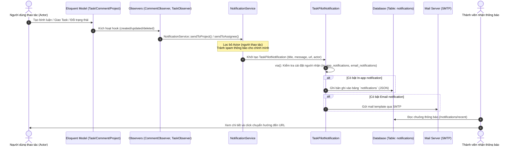

# TÀI LIỆU KIẾN TRÚC HỆ THỐNG: AI RECOMMENDATION, DATABASE POLYMORPHISM & NOTIFICATIONS

```text
Dự án:            TaskPilot - Nền tảng Quản trị Dự án Thông minh
Tài liệu:         Giải thích Luồng Hoạt động AI, Cột commentable_type, Hệ thống Thông báo & Backend
Phiên bản:        2.0.0
Ngày cập nhật:    30/10/2026
Tác giả:          TaskPilot Engineering & Architecture Team
```

---

## MỤC LỤC
1. [Cột `commentable_type` trong Cơ sở dữ liệu là gì?](#1-cột-commentable_type-trong-cơ-sở-dữ-liệu-là-gì)
2. [Cơ chế hoạt động của Hệ thống Thông báo (Notification System)](#2-cơ-chế-hoạt-động-của-hệ-thống-thông-báo-notification-system)
3. [Tổng quan Luồng hoạt động AI (AI Recommendation Workflow)](#3-tổng-quan-luồng-hoạt-động-ai-ai-recommendation-workflow)
4. [Luồng chi tiết Gợi ý phía Backend (Detailed Backend Architecture)](#4-luồng-chi-tiết-gợi-ý-phía-backend-detailed-backend-architecture)

---

## 1. CỘT `commentable_type` TRONG CƠ SỞ DỮ LIỆU LÀ GÌ?

### 1.1. Khái niệm & Bản chất kỹ thuật
Trong cơ sở dữ liệu TaskPilot, cột `commentable_type` thuộc bảng `comments` là một cột dạng chuỗi (`VARCHAR(255)`), đóng vai trò cấu thành mối quan hệ **Đa hình (Polymorphic Relations)** trong Laravel Eloquent ORM.

Quan hệ đa hình cho phép một Model (ở đây là `Comment`) thuộc về (**belongsTo**) nhiều hơn một loại Model khác nhau chỉ với **duy nhất một bảng lưu trữ**.

```sql
-- Trích đoạn Migration tạo bảng comments (database/migrations/2017_09_09_082113_create_comments_table.php)
Schema::create('comments', function (Blueprint $table) {
    $table->increments('id');
    $table->longText('body');
    $table->string('url', 255)->nullable();
    $table->integer('user_id')->unsigned();
    $table->integer('commentable_id')->unsigned(); // ID của đối tượng cha
    $table->string('commentable_type');            // Class Name của đối tượng cha
    $table->foreign('user_id')->references('id')->on('users');
    $table->timestamps();
});
```

### 1.2. Cặp bài trùng: `commentable_id` & `commentable_type`
Nếu chỉ có `commentable_id = 15`, hệ cơ sở dữ liệu sẽ **không thể biết** bình luận này thuộc về công việc số 15 hay dự án số 15. Do đó, Laravel sử dụng cặp hai cột:

| Cột | Ý nghĩa | Ví dụ giá trị thực tế |
| :--- | :--- | :--- |
| `commentable_id` | Khóa chính (Primary Key ID) của bản ghi cha | `2941`, `10`, `5` |
| `commentable_type` | Tên lớp đầy đủ (Fully Qualified Class Name) của Model | `ProjectsManager\Task`, `ProjectsManager\Project` |

#### Ví dụ dữ liệu thực tế trong bảng `comments`:
| id | body | user_id | commentable_id | commentable_type | Ý nghĩa thực tế |
| :--- | :--- | :--- | :--- | :--- | :--- |
| 1 | "Đã fix xong layout avatar" | 1 | 2941 | `ProjectsManager\Task` | Bình luận trên **Task #2941** |
| 2 | "Kế hoạch tuần này cần review" | 2 | 10 | `ProjectsManager\Project` | Bình luận trên **Project #10** |

### 1.3. Khai báo trong Code Eloquent Model
Tại file `app/Comment.php`:
```php
class Comment extends Model
{
    protected $fillable = [
        'body', 'url', 'commentable_id', 'commentable_type', 'user_id',
    ];

    // Khai báo morphTo: Laravel tự động căn cứ vào commentable_type và commentable_id
    // để trả về đối tượng Model tương ứng (Task hoặc Project)
    public function commentable()
    {
        return $this->morphTo();
    }
}
```

Tại file `app/Task.php` và `app/Project.php`:
```php
// Một Task có thể có nhiều comments
public function comments()
{
    return $this->morphMany('ProjectsManager\Comment', 'commentable');
}
```

### 1.4. Lợi ích kiến trúc
1. **Tiết kiệm tài nguyên & chuẩn hóa DB:** Không cần tạo nhiều bảng riêng lẻ như `task_comments`, `project_comments`, `sprint_comments`...
2. **Dễ dàng mở rộng (Extensible):** Khi sau này hệ thống có thêm đối tượng mới (ví dụ `WikiPage`, `Ticket`), ta chỉ cần thêm quan hệ `morphMany` mà không cần chạy migration sửa lại cấu trúc bảng cơ sở dữ liệu.
3. **Ứng dụng trong `CommentObserver.php`:**
   Dựa vào `commentable_type`, Observer phân biệt ngữ cảnh để:
   - Nếu là `ProjectsManager\Task`: Truy vấn `Task::find($commentable_id)->project_id`, tạo URL `/tasks/{id}`, sinh nhãn "công việc [Tên Task]".
   - Nếu là `ProjectsManager\Project`: Lấy trực tiếp `$commentable_id`, tạo URL `/projects/{id}`, sinh nhãn "dự án [Tên Project]".

---

## 2. CƠ CHẾ HOẠT ĐỘNG CỦA HỆ THỐNG THÔNG BÁO (NOTIFICATION SYSTEM)

Hệ thống thông báo của TaskPilot được thiết kế theo mô hình **Event-Driven & Observer Pattern**, hỗ trợ đa kênh (**Multi-channel: In-app Bell & Email SMTP**).



### 2.1. Tầng kích hoạt (Triggers via Eloquent Observers)
Thay vì nhồi nhét logic gửi thông báo vào Controller, hệ thống sử dụng các Observers đăng ký trong `AppServiceProvider`:
- `TaskObserver`: Theo dõi khi task được tạo mới, phân công lại nhân sự (`assignee_id`), đổi trạng thái (`status`), hoặc đổi sprint.
- `CommentObserver`: Theo dõi khi có bình luận mới, sửa hoặc xóa bình luận.
- `ProjectObserver`: Theo dõi thêm thành viên dự án, cập nhật tiến độ dự án.

### 2.2. Tầng điều phối nghiệp vụ (`app/Services/NotificationService.php`)
Chịu trách nhiệm xác định danh sách người nhận và chuẩn hóa nội dung:
- `sendToProject(Project $project, ...)`: Gửi cho toàn bộ thành viên đang tham gia dự án.
- `sendToAssignee(Task $task, ...)`: Gửi riêng cho người đang chịu trách nhiệm task.
- `sendToTaskCreator(Task $task, ...)`: Gửi thông báo cho người đã tạo ra task.
- **Tự động lọc Actor:** Luôn chạy hàm `prepareRecipients()` nhằm loại trừ `actor->id` (người vừa nhấn nút gửi không bao giờ bị nhận lại thông báo của chính mình).

### 2.3. Lớp chuyển giao thông báo (`app/Notifications/TaskPilotNotification.php`)
- Kế thừa `Illuminate\Notifications\Notification`.
- Phương thức `via($notifiable)` kiểm tra tùy chọn cá nhân của người nhận trong bảng `users`:
  ```php
  public function via($notifiable): array
  {
      $channels = [];
      if ($notifiable->in_app_notifications ?? true) {
          $channels[] = 'database';
      }
      if ($notifiable->email_notifications ?? true) {
          $channels[] = 'mail';
      }
      return !empty($channels) ? $channels : ['database'];
  }
  ```
- **Kênh Database:** Dữ liệu được lưu dạng JSON trong bảng chuẩn `notifications` của Laravel:
  `['event_type', 'title', 'message', 'url', 'actor_id', 'actor_name', 'actor_avatar', 'data']`.
- **Kênh Mail:** Tạo thư điện tử thân thiện với tiêu đề `TaskPilot - [Tiêu đề]`, lời chào, nội dung thông báo, người thực hiện và nút CTA dẫn thẳng tới trang task/project.

### 2.4. Phía giao diện hiển thị (Frontend Bell & Polling)
- Giao diện góc phải thanh Header (`resources/views/partials/notification_bell.blade.php`).
- Frontend gửi request định kỳ tới các endpoint:
  - `GET /notifications/unread-count`: Đếm số lượng thông báo chưa đọc hiển thị lên Badge đỏ.
  - `GET /notifications/recent`: Lấy danh sách 10 thông báo mới nhất khi nhấn mở chuông.
  - `POST /notifications/{id}/read`: Đánh dấu một thông báo đã đọc.
  - `POST /notifications/read-all`: Đánh dấu toàn bộ là đã đọc.

---

## 3. TỔNG QUAN LUỒNG HOẠT ĐỘNG AI (AI RECOMMENDATION WORKFLOW)

Hệ thống AI của TaskPilot có nhiệm vụ **tự động gợi ý nhân sự phù hợp nhất (Assignee Recommendation)** cho từng công việc, giải quyết bài toán: *Đúng người, đúng kỹ năng, cân bằng tải công việc, tối ưu tiến độ*.

```mermaid
graph TD
    subgraph Client [1. Client / UI Layer]
        VueForm["TaskCreate.vue / TaskDetail (Inline) / AiBatchSuggest.vue"]
    end

    subgraph LaravelApp [2. Laravel Core Backend]
        Controller["AiRecommendationController"]
        PolicyCheck{"Kiểm tra TaskPolicy"}
        Service["AiRecommendationService"]
        DBQuery["Truy vấn Thành viên Dự án, Kỹ năng & Lịch sử Task cũ"]
        ProcessBridge["Symfony Process (IPC Subprocess Bridge)"]
    end

    subgraph PythonEngine [3. Python AI Engine (assignee_recommender.py)]
        InputParser["Nhận JSON qua STDIN"]
        NLP["TF-IDF Vectorizer (N-gram 1-2, sublinear_tf)"]
        DomainMatch["So khớp Kỹ năng (Skill Overlap & Domain Hints)"]
        HistoryRank["Phân tích Lịch sử đảm nhận Issue tương tự"]
        WorkloadBalancing["Cân bằng tải: Phạt quá tải / Thưởng rảnh rỗi"]
        Ensemble["Bộ tổng hợp điểm (Hybrid Ensemble Scorer)"]
        XAI["Bộ tạo lý do minh bạch (Explainable AI - match_reasons)"]
        Confidence["Hiệu chuẩn độ tin cậy % (Confidence Calibration)"]
    end

    subgraph OutputPersist [4. Output & Logging]
        JSONOut["Xuất JSON qua STDOUT"]
        DBLog["Ghi log ai_assignee_recommendations"]
        ReturnUI["Hiển thị Top 3/5 Ứng viên + % Match + Lý do chi tiết"]
    end

    VueForm -->|POST /tasks/ai-recommend| Controller
    Controller --> PolicyCheck
    PolicyCheck -->|Hợp lệ| Service
    Service --> DBQuery
    DBQuery --> ProcessBridge
    ProcessBridge -->|Pipes JSON| InputParser
    InputParser --> NLP
    InputParser --> DomainMatch
    InputParser --> HistoryRank
    InputParser --> WorkloadBalancing
    NLP --> Ensemble
    DomainMatch --> Ensemble
    HistoryRank --> Ensemble
    WorkloadBalancing --> Ensemble
    Ensemble --> XAI
    Ensemble --> Confidence
    Confidence --> JSONOut
    JSONOut --> ProcessBridge
    ProcessBridge --> DBLog
    DBLog --> ReturnUI
```

---

## 4. LUỒNG CHI TIẾT GỢI Ý PHÍA BACKEND (DETAILED BACKEND ARCHITECTURE)

### Bước 1: Tiếp nhận yêu cầu & Ủy quyền (Routing & Authorization)
- Khi người dùng gõ tiêu đề, mô tả task hoặc mở popup gợi ý hàng loạt trong Sprint, Frontend gửi POST request:
  - Gợi ý đơn lẻ: `POST /tasks/ai-recommend` (Dữ liệu: `name`, `description`, `project_id`, `issue_type`, `priority`, `components`, `labels`).
  - Gợi ý hàng loạt: `POST /projects/{id}/ai/batch-suggest` (Dữ liệu: danh sách task IDs).
- `AiRecommendationController` kiểm tra quyền qua Laravel Gate:
  ```php
  $this->authorize('recommend', Task::class);
  ```

### Bước 2: Khai thác Ngữ cảnh tại Service (`AiRecommendationService.php`)
Service không gửi dữ liệu thô mà tiến hành xây dựng ngữ cảnh toàn diện (**Context Enrichment**):
1. **Tập ứng viên tiềm năng (`getCandidateUsers`)**:
   - Truy vấn toàn bộ thành viên đang `active` thuộc dự án đó (kèm theo quan hệ `skills`: tên kỹ năng, cấp độ `proficiency_level`, số năm kinh nghiệm).
2. **Khối lượng công việc thời gian thực (`active_tasks_count`)**:
   - Đếm số lượng task đang mở (loại trừ `done`, `closed`, `completed`, `resolved`) của từng thành viên.
3. **Lịch sử dự án (`historyTasksForProject`)**:
   - Lấy tối đa 50 task đã hoàn thành gần nhất trong dự án gồm: `summary`, `assignee`, `issuetype`, `components`.
4. **Đóng gói Payload JSON**:
   - Toàn bộ dữ liệu được gói gọn thành một Payload có cấu trúc chuẩn để sẵn sàng truyền sang Python.

### Bước 3: Cầu nối tiến trình IPC (`runPythonProcess`)
Backend sử dụng Symfony `Process` để gọi script Python độc lập mà không cần duy trì web-server Python nặng nề:
```php
$process = new Process(
    [$pythonBinary, '-B', $scriptPath, 'predict', '--issue-json', '-', '--top-k', (string) $topK],
    base_path()
);
$process->setInput(json_encode($payload, JSON_UNESCAPED_UNICODE));
$process->setTimeout(20);
$process->mustRun();
```
- Lợi ích:
  - Cờ `-B`: Ngăn chặn tạo file rác bytecode `.pyc`.
  - Input qua `STDIN ('-')`: Tránh giới hạn độ dài tham số dòng lệnh OS (Command line length limit) khi task có mô tả dài hoặc nhiều ứng viên.
  - Timeout an toàn: Đảm bảo nếu quá thời gian sẽ tự ngắt, có fallback an toàn.

### Bước 4: Thuật toán Tính điểm trong Python (`AI/assignee_recommender.py`)
Script Python tiếp nhận JSON và chạy bộ giải thuật đa tầng kết hợp:

1. **Trích xuất thuộc tính văn bản (NLP Feature Extraction):**
   - Loại bỏ stop-words, tách token từ `summary`, `description`, `labels`, `components`.
   - Tính toán độ tương đồng Cosine ngữ nghĩa giữa mô tả công việc và hồ sơ năng lực của ứng viên.
2. **Khớp kỹ năng chuyên môn (Skill Overlap Score):**
   - So khớp trực tiếp kỹ năng của ứng viên với từ khóa nhiệm vụ (`skill_matches`).
   - Nhận diện kỹ năng miền mở rộng qua bộ từ điển gợi ý domain (`DOMAIN_HINTS`), ví dụ: task có từ khóa `mysql, deadlock, migration` sẽ tự động liên kết tới kỹ năng `Database, Backend, DBA`.
3. **Phân tích lịch sử nhiệm vụ (Historical Experience Score):**
   - Tính toán mức độ thường xuyên ứng viên từng giải quyết các nhiệm vụ cùng phân loại (`issue_type`), cùng thành phần module trong quá khứ.
4. **Cơ chế cân bằng khối lượng công việc (Workload Balancing Fairness):**
   - Nếu ứng viên đang có **0 task**: Được cộng điểm ưu tiên sẵn sàng (`availability_bonus = +0.08`).
   - Nếu có **1 - 2 task**: Cộng nhẹ (`+0.04`).
   - Nếu đang gánh **>= 5 task**: Bị trừ điểm quá tải (`workload_penalty = (workload - 4) * 0.05`), tối đa trừ `0.35`. Điều này ngăn tình trạng dồn hết việc cho một Lead developer.
5. **Công thức tính điểm tổng hợp (Hybrid Heuristic Formulation):**
   $$\text{Score}_{\text{raw}} = 3.5 \times \text{SemanticSim} + 4.0 \times \text{HistoryScore} + 1.5 \times \text{MatchedSkills} + 1.1 \times \text{HintSkills} + \text{TypeBonus} + \text{WorkloadAdj}$$
6. **Giải thích quyết định AI (Explainable AI - XAI):**
   - Hàm `generate_match_reasons()` sinh ra các câu lý do trực quan bằng ngôn ngữ tự nhiên:
     - *"Có 3 kỹ năng phù hợp trực tiếp: PHP, Laravel, MySQL"*
     - *"Đã hoàn thành 5 nhiệm vụ tương tự trong dự án này"*
     - *"Khối lượng công việc hiện tại thuận lợi (0 nhiệm vụ đang xử lý)"*

### Bước 5: Ánh xạ kết quả & Lưu trữ Lịch sử (Mapping & Persistence)
1. Python trả về danh sách Top-K ứng viên xếp hạng cao nhất qua `STDOUT`.
2. Laravel Service giải mã JSON, đối soát thông tin `user_id` với cơ sở dữ liệu `User` hiện tại.
3. Tự động ghi lại quyết định gợi ý vào bảng `ai_assignee_recommendations`:
   ```php
   AiAssigneeRecommendation::create([
       'task_id' => $taskData['task_id'],
       'user_id' => $formatted['user_id'],
       'score' => $formatted['score'],
       'rank_position' => $formatted['rank_position'],
       'match_reasons' => $formatted['match_reasons'],
       'status' => 'pending', // Sẽ chuyển thành 'accepted' nếu người dùng bấm chọn
   ]);
   ```
4. Dữ liệu này giúp ban quản trị theo dõi độ chính xác của AI và đóng vai trò dữ liệu huấn luyện phản hồi (**Feedback Loop**) cho các chu kỳ Retraining tiếp theo.
5. Trả về kết quả JSON cho Vue Component hiển thị trực tiếp lên giao diện người dùng.

---
*Tài liệu được lưu trữ trực tiếp trong thư mục `docs/KIEN_TRUC_AI_VA_LUONG_HE_THONG.md` phục vụ việc tra cứu, kiểm thử và bàn giao hệ thống.*

