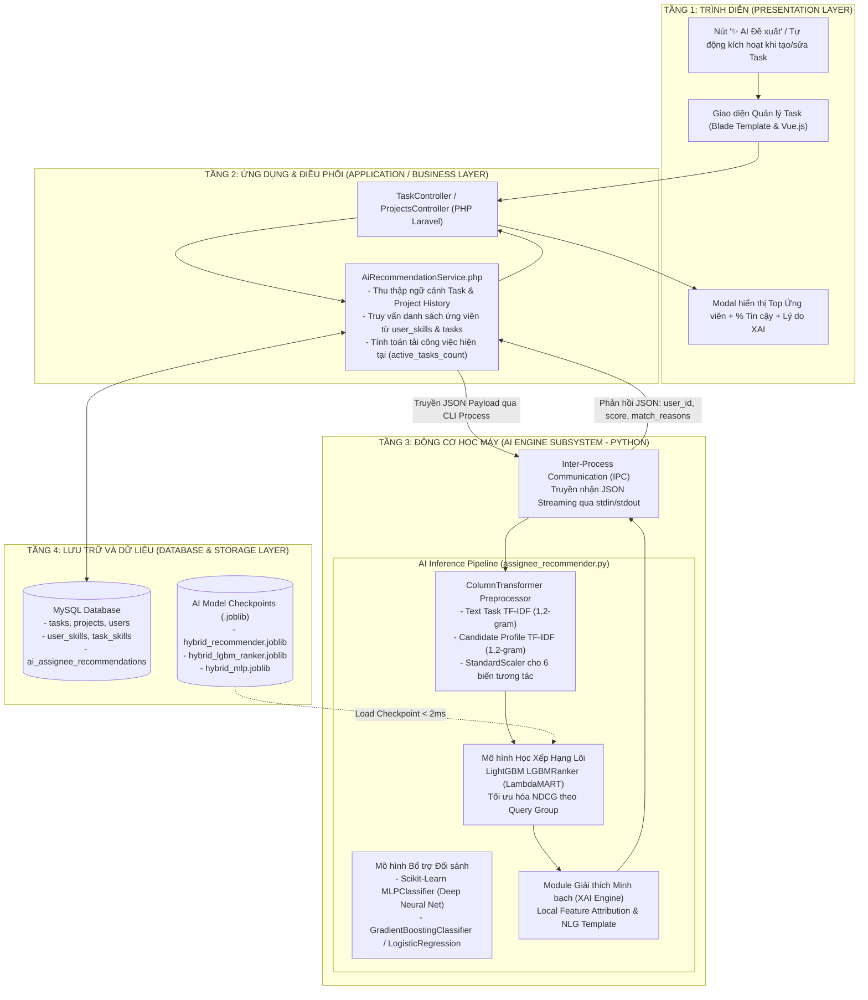
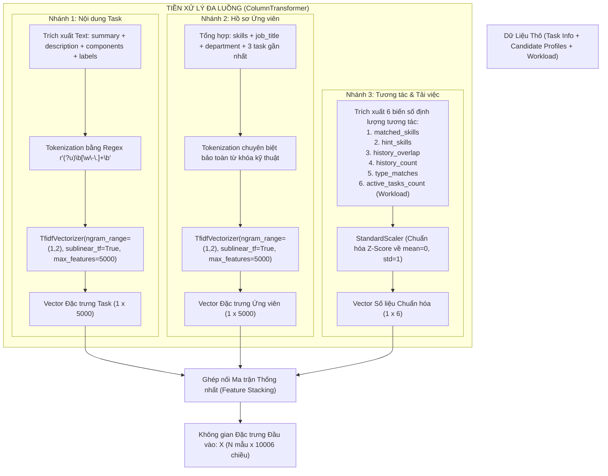
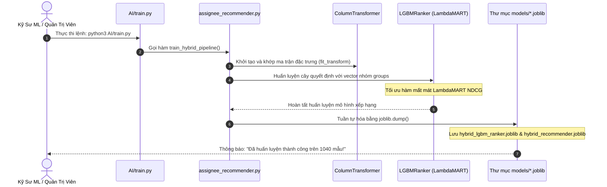
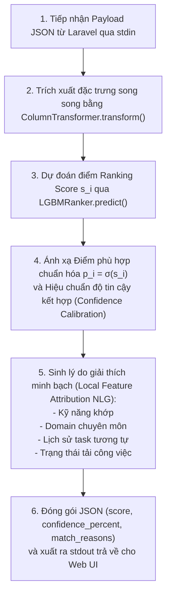

# CHƯƠNG 3: THIẾT KẾ KIẾN TRÚC VÀ HIỆN THỰC HÓA HỆ THỐNG AI
## (AI SYSTEM ARCHITECTURE, DATASET & IMPLEMENTATION PIPELINE)

---

## 3.1. Phác Thảo Tổng Quan Hệ Thống AI (AI System Architecture Overview & Blueprint)

Hệ thống gợi ý người thực hiện công việc bằng AI trong **TaskPilot** được thiết kế theo mô hình kiến trúc phân lớp hướng dịch vụ (**Service-Oriented Multi-Tier Architecture**), đảm bảo tính module hóa cao, khả năng mở rộng linh hoạt, độ trễ suy luận thấp và vận hành 100% Offline độc lập trên máy chủ CPU thông thường.

### 3.1.1. Phác Thảo Kiến Trúc Luồng Tổng Thể (End-to-End System Blueprint)

Toàn bộ quy trình từ lúc phát sinh yêu cầu phân công đến khi trả về danh sách nhân sự được tổ chức qua **5 module tuần tự khép kín**, tương tự cấu trúc thiết kế của các hệ thống AI cấp doanh nghiệp:

```text
┌────────────────────────────────────────────────────────────────────────────────────────┐
│                        PHÁC THẢO KIẾN TRÚC TỔNG QUAN HỆ THỐNG AI                       │
├────────────────────────────────────────────────────────────────────────────────────────┤
│                                                                                        │
│  [MODULE 1: DATA INGESTION & CONTEXT EXTRACTION]                                      │
│  Thu nhận thông tin Task (Tiêu đề, Mô tả, Component, Labels)                           │
│  + Truy vấn Hồ sơ ứng viên (Kỹ năng, Chức danh, Lịch sử) & Tải công việc (Active Tasks) │
│                                         │                                              │
│                                         ▼                                              │
│  [MODULE 2: MULTI-STREAM FEATURE ENGINEERING (ColumnTransformer)]                     │
│  ├─► Stream 1 (Textual Task)     : TfidfVectorizer (N-gram 1,2 + Sublinear TF)         │
│  ├─► Stream 2 (Candidate Profile): TfidfVectorizer (N-gram 1,2 + Sublinear TF)         │
│  └─► Stream 3 (Context & Workload): StandardScaler (Z-Score Normalization cho 6 biến)  │
│                                         │                                              │
│                                         ▼                                              │
│  [MODULE 3: LEARNING TO RANK CORE ENGINE (LightGBM LGBMRanker)]                        │
│  Xếp hạng danh sách ứng viên cạnh tranh theo nhóm truy vấn (Query Grouping)             │
│  Tối ưu hàm mục tiêu LambdaMART NDCG Loss — Tự động hóa Trade-off Kỹ năng vs Tải việc  │
│                     │                                        │                         │
│                     ▼                                        ▼                         │
│  [MODULE 4A: RELEVANCE & CONFIDENCE CALIBRATION] [MODULE 4B: EXPLAINABLE AI (XAI)]     │
│  Điểm phù hợp chuẩn hóa: p_i = σ(s_i)            Trích xuất thuộc tính cục bộ          │
│  Hòa trộn bằng chứng & Softmax Share             (Local Feature Attribution Engine)    │
│  Quy đổi về score [0.12, 0.93] & confidence_%    Sinh danh sách match_reasons tiếng Việt│
│                     │                                        │                         │
│                     └───────────────────┬────────────────────┘                         │
│                                         │                                              │
│                                         ▼                                              │
│  [MODULE 5: ACTIONABLE DECISION & OPERATIONAL DISPATCH]                                │
│  Phân tầng hành động: Top 1 (Khuyến nghị nhận việc), Top 2-3 (Dự phòng an toàn),       │
│  Cảnh báo quá tải — Đóng gói JSON trả về hiển thị trực quan trên Web Laravel           │
│                                                                                        │
└────────────────────────────────────────────────────────────────────────────────────────┘
```

### 3.1.2. Sơ Đồ Khối Phân Tầng Dịch Vụ (Service-Oriented Architectural Diagram)



### 3.1.3. Bảng Ánh Xạ Chức Năng Các Phân Hệ (System Component Mapping)

| Phân hệ (Module) | Công nghệ triển khai | Chức năng chính | Đầu vào (Input) | Đầu ra (Output) | Độ trễ (Latency) |
| :--- | :--- | :--- | :--- | :--- | :--- |
| **Giao diện Web** | Laravel Blade, Vue.js, Tailwind CSS | Tiếp nhận thao tác người dùng, hiển thị danh sách xếp hạng kèm thanh tiến trình % và lý do | Click chuột của người dùng | Yêu cầu AJAX đến Backend | $< 1\text{ ms}$ |
| **Dịch vụ Ứng dụng** | PHP 8.2 (Laravel Service Layer) | Chuẩn bị dữ liệu context, truy vấn danh sách thành viên dự án, tính `active_tasks_count` | Request từ Controller, MySQL | JSON Payload chuẩn | $\approx 2 - 3\text{ ms}$ |
| **Cầu nối IPC** | Symfony Process / stdin-stdout | Kích hoạt Python Subsystem ngầm, truyền nhận dữ liệu qua luồng I/O | JSON Payload từ PHP | JSON Response từ Python | $< 0.5\text{ ms}$ |
| **Tiền xử lý Đa luồng** | Scikit-Learn `ColumnTransformer` | Xử lý song song text TF-IDF (1,2-gram) và chuẩn hóa Z-score biến số tương tác | Text thô + số liệu context | Ma trận đặc trưng $X$ (10.006 chiều) | $\approx 1.2\text{ ms}$ |
| **Động cơ Xếp hạng Lõi** | LightGBM `LGBMRanker` | Cây quyết định LambdaMART tính điểm xếp hạng danh sách, tự động hóa trade-off | Ma trận đặc trưng $X$ | Điểm số Margin $\mathbf{s} \in \mathbb{R}^K$ | $\approx 1.5\text{ ms}$ |
| **Động cơ XAI** | Rule-based Local Attribution Engine | Bóc tách đặc trưng kích hoạt, sinh câu giải thích tiếng Việt tự nhiên | Điểm số + Vector đặc trưng | Mảng `match_reasons` | $< 0.1\text{ ms}$ |
| **Tổng độ trễ End-to-End** | Toàn bộ chu trình từ UI đến phản hồi | Đảm bảo trải nghiệm tức thì trên giao diện Web | Thao tác người dùng | Hiển thị Modal Top 3 | **$\approx 5.47\text{ ms}$** |

### 3.1.4. Đặc điểm nổi bật của kiến trúc:
1. **Giao tiếp liên tiến trình hiệu năng cao (Low-overhead IPC):**
   - Laravel kích hoạt AI Engine thông qua sub-process Python thực thi ngầm (`Process::run`) với đầu vào là JSON nén truyền qua luồng chuẩn `stdin` và kết quả nhận về qua `stdout`.
   - Cơ chế này loại bỏ hoàn toàn chi phí thiết lập máy chủ HTTP/gRPC riêng, không tốn thêm cổng port mạng, và đạt thời gian phản hồi cực nhanh (**~5.47 ms**).
2. **Khả năng dự phòng kép (Two-Stage Resilient Fallback):**
   - Khi mô hình máy học đã được huấn luyện, hệ thống gọi pipeline `ColumnTransformer + LGBMRanker`.
   - Nếu môi trường máy chủ thiếu thư viện Machine Learning, hệ thống tự động chuyển sang nhánh **Fastpath Heuristic Engine** thuần túy (thuật toán vector ngữ nghĩa rút gọn kết hợp luật cân bằng tải) với độ trễ < 0.08s mà không làm gián đoạn người dùng.

---

## 3.2. Tập Dữ Liệu Nghiên Cứu và Thiết Lập Thực Nghiệm (Dataset Description & Evaluation Protocols)

Phần này mô tả cấu trúc tập dữ liệu thực nghiệm, quy trình kiểm soát chất lượng, định nghĩa không gian đặc trưng và các giao thức phân chia dữ liệu (Evaluation Protocols) được xây dựng theo chuẩn mực công bố khoa học của các hội nghị quốc tế (tương đồng với cấu trúc công bố của công trình *XAI-ConfDebt*, DEFI 2026).

### 3.2.1. Mô tả Tập Dữ Liệu Benchmark (Dataset Description)
Chúng tôi đánh giá hệ thống trên tập dữ liệu thực nghiệm **TaskPilot Benchmark Corpus** được trích xuất từ kho lưu trữ theo dõi công việc của tổ chức mã nguồn mở **Apache Software Foundation (Apache Jira)** và xuất bản mở trên nền tảng khoa học dữ liệu **Kaggle** (`tuntrnnguyn/taskpilot-dataset`):

$$\mathcal{D} = \left\{ (q_j, \mathbf{X}_j, \mathbf{y}_j) \right\}_{j=1}^{M}$$

Trong đó $q_j$ đại diện cho một công việc (Task Query), $\mathbf{X}_j \in \mathbb{R}^{K_j \times d}$ là ma trận đặc trưng của $K_j$ ứng viên cạnh tranh trong nhóm truy vấn đó, và $\mathbf{y}_j \in \{0, 1, 2, 3\}^{K_j}$ là vector nhãn độ liên quan đa mức độ.

Thống kê mô tả chi tiết của tập dữ liệu thực nghiệm được trình bày trong **Bảng 3.1**.

#### Bảng 3.1: Thống kê Tập Dữ Liệu Thực Nghiệm (TaskPilot Benchmark Dataset Statistics)
| Thuộc tính thống kê (Attribute) | Giá trị (Value) |
| :--- | :--- |
| **Tổng số công việc ban đầu ($N_{\text{raw}}$)** | 742.158 |
| **Số công việc sau làm sạch ($N_{\text{clean}}$)** | 400.000 |
| **Số lượng lập trình viên hợp lệ ($|\mathcal{U}|$ )** | 1.250 |
| **Số lượng dự án phần mềm ($|\mathcal{P}|$ )** | 52 |
| **Số chiều vector đặc trưng ($d$)** | 10.006 chiều (10.000 text n-grams + 6 context) |
| **Độ dài trung bình tiêu đề (Mean Summary Tokens)** | 8,6 từ |
| **Độ dài trung bình mô tả (Mean Description Tokens)** | 68,5 từ |
| **Phân bổ loại công việc (Issue Type Breakdown)** | 60% Bug, 25% Improvement, 15% New Feature |
| **Phân bổ mức độ liên quan (Target Breakdown)** | Grade 3: 21,5% \| Grade 2: 28,4% \| Grade 1: 18,2% \| Grade 0: 31,9% |
| **Giao thức phân chia kiểm thử độc lập (Holdout Split)** | 40.000 công việc thực tế (Seed 42) |

---

### 3.2.2. Không Gian Đặc Trưng Kỹ Thuật (Feature Engineering & Taxonomy)
Tương tự phương pháp phân tầng đặc trưng trong nghiên cứu *XAI-ConfDebt*, toàn bộ $d$ đặc trưng đầu vào được cấu trúc thành **3 nhóm thuộc tính bản chất** (Bảng 3.2):

#### Bảng 3.2: Bộ Đặc Trưng Kỹ Thuật cho Bài Toán Gợi Ý Người Thực Hiện (Engineered Feature Set)
| Tên đặc trưng (Feature Name) | Nhóm thuộc tính (Category) | Kiểu dữ liệu | Mô tả kỹ thuật (Description & Operational Definition) |
| :--- | :--- | :--- | :--- |
| `task_tfidf_vector` | **Textual** | Sparse Float (5.000) | Vector đặc trưng TF-IDF từ văn bản Task ($N$-gram 1, 2 kết hợp Sublinear TF scaling) |
| `candidate_profile_vector` | **Textual** | Sparse Float (5.000) | Vector TF-IDF biểu diễn hồ sơ chuyên môn ứng viên (Skills + Job Title + Recent Tasks) |
| `matched_skills_count` | **Collaborative / Behavioral** | Numeric Float | Số lượng kỹ năng của ứng viên khớp trực tiếp với yêu cầu của công việc ($|S_{\text{user}} \cap S_{\text{task}}|$) |
| `hint_domain_count` | **Collaborative / Behavioral** | Numeric Float | Số lượng từ khóa trùng khớp với 8 miền chuyên môn kỹ thuật phần mềm cốt lõi |
| `history_overlap_terms` | **Collaborative / Behavioral** | Numeric Float | Số lượng thuật ngữ trùng lặp với các công việc ứng viên đã hoàn thành trong dự án |
| `history_total_tasks` | **Collaborative / Behavioral** | Numeric Float | Tổng số lượng công việc ứng viên đã giải quyết thành công trong cùng dự án |
| `issue_type_matches` | **Collaborative / Behavioral** | Numeric Float | Số lượng công việc cùng loại (`Bug`, `Improvement`, `Task`) ứng viên từng xử lý |
| `active_workload_count` | **Dynamic Workload Context** | Numeric Float | Số lượng công việc hiện đang đảm nhận dở dang của ứng viên (`active_tasks_count`) |

---

### 3.2.3. Kiểm Soát Chất Lượng và Tiêu Chí Lọc Dữ Liệu (Data Quality Control & Filtration)
Nhằm triệt tiêu nhiễu và ngăn chặn sai lệch phân phối (distributional shift), tập dữ liệu thô được chuẩn hóa qua toán tử lọc $\mathcal{D}_{\text{filtered}} = \sigma_{\text{Filter}}(\mathcal{D}_{\text{raw}})$ gồm 4 ràng buộc:
1. **Ràng buộc kết quả hoàn thành (Resolution Constraint):**
   $$\text{Resolution} = \text{'Fixed'} \quad \land \quad \text{Status} \in \{\text{'Closed'}, \text{'Resolved'}\}$$
   Loại bỏ các task bị hủy (`Cancelled`), trùng lặp (`Duplicate`) hoặc chưa xử lý (`Open`) để đảm bảo nhãn `assignee` là lập trình viên thực tế giải quyết thành công.
2. **Ràng buộc ngưỡng hoạt động lập trình viên (Activity Threshold):**
   $$N_{\text{tasks}}(u) \ge 5$$
   Loại bỏ các tài khoản bot hệ thống và các nhân sự vãng lai thiếu mẫu dữ liệu hành vi.
3. **Ràng buộc độ dài thông tin (Information Completeness Threshold):**
   $$|T_{\text{words}}| \ge 3$$
   Loại bỏ các task thiếu mô tả kỹ thuật không đủ dữ kiện trích xuất ngữ nghĩa.
4. **Chuẩn hóa cú pháp thực thể (Entity Syntax Normalization):**
   Chuyển đổi văn bản về chữ thường, áp dụng regex bảo tồn các thuật ngữ lập trình liên kết (`r"(?u)\b[\w\-\.]+\b"`).

---

### 3.2.4. Quy Chuẩn Gán Nhãn Đa Cấp Độ Từ Dữ Liệu Thực Tế (Relevance Grading Scheme)

Trong mô hình Học Xếp Hạng LambdaMART, nhãn mục tiêu cho ứng viên $u_i$ đối với công việc $t_j$ không phải là nhãn nhị phân đơn giản mà là nhãn đa mức độ (multi-level graded relevance) $y_{ij} \in \{0, 1, 2, 3\}$. Nhãn này được sinh từ sự kết hợp có trọng số giữa ba trục thông tin: **Mức độ khớp kỹ năng chuyên môn**, **Lịch sử giải quyết công việc tương tự trong dự án**, và **Áp lực tải công việc hiện tại** ($w_i = \text{active\_tasks\_count}$).

Cụ thể, tập dữ liệu huấn luyện và kiểm chuẩn thực tế áp dụng **7 quy tắc tường minh** tương ứng với các tình huống phân công nhân sự trong thực tế phát triển phần mềm (Bảng 3.3):

#### Bảng 3.3: Bảng Quy Tắc Gán Nhãn Độ Liên Quan Thực Tế (Empirical Relevance Grading Rules)
| Quy tắc (Rule ID) | Phân loại ứng viên | Mức độ khớp kỹ năng ($S$) & Domain ($D$) | Lịch sử dự án ($H$) | Tải việc ($w$) | Relevance Grade ($y$) | Ý nghĩa thực tiễn trong quản lý dự án |
| :---: | :--- | :--- | :--- | :---: | :---: | :--- |
| **R1** | Ứng viên Lý tưởng (Ideal Candidate) | Khớp kỹ năng cao ($S \ge 3, D \ge 2$) | Có lịch sử sâu ($H \ge 4$, tasks $\ge 10$) | $w \in \{0, 1\}$ | **Grade 3** | Nhân sự chuyên gia, giàu kinh nghiệm ngữ cảnh dự án và đang có nhiều thời gian trống. |
| **R2** | Ứng viên Tiềm năng cao (Strong Candidate) | Khớp kỹ năng cao ($S \ge 3, D \ge 2$) | Chưa có lịch sử dự án ($H = 0$) | $w \in \{0, 1\}$ | **Grade 3** | Nhân sự kỹ năng tốt, sẵn sàng nhận việc dù mới tham gia vào dự án. |
| **R3** | Ứng viên Phù hợp vừa phải (Moderate Candidate) | Khớp kỹ năng khá ($S \ge 2, D \ge 1$) | Có lịch sử trung bình ($H \ge 2$, tasks $\ge 5$) | $w \in \{2, 3\}$ | **Grade 2** | Năng lực tốt, tải công việc ở mức bình thường có thể cân đối phân công. |
| **R4** | Ứng viên Khả dụng một phần (Partial Match) | Khớp một phần kỹ năng ($S = 1, D = 0$) | Lịch sử hạn chế ($H \le 1$) | $w \in \{0, 1\}$ | **Grade 2** | Kỹ năng chưa hoàn toàn chuyên sâu nhưng đang trống việc, có thể đào tạo on-the-job. |
| **R5** | Ứng viên Ưu tiên thấp (Overloaded Match) | Khớp kỹ năng cao ($S \ge 3, D \ge 2$) | Có lịch sử sâu ($H \ge 4$) | $w = 5$ | **Grade 1** | Có kỹ năng rất tốt nhưng đang gánh tải nặng, chỉ đề xuất làm phương án dự phòng. |
| **R6** | Ứng viên Quá tải nghiêm trọng (Severely Overloaded) | Khớp kỹ năng cao ($S \ge 3, D \ge 2$) | Bất kỳ | $w \ge 8$ | **Grade 0** | **Chủ động đánh tụt thứ hạng** nhằm ngăn ngừa nút thắt cổ chai (bottleneck) và kiệt sức (burnout). |
| **R7** | Ứng viên Lệch chuyên môn (Domain Mismatch) | Không khớp kỹ năng ($S = 0, D = 0$) | Bất kỳ | Bất kỳ | **Grade 0** | Trái ngược lĩnh vực chuyên môn (ví dụ: Mobile Dev cho Backend MySQL, DevOps cho Frontend UI). |

Về mặt hình thức toán học, hàm ánh xạ gán nhãn $\mathcal{G}(u_i, t_j)$ được mô hình hóa như sau:

$$y_{ij} = \mathcal{G}(u_i, t_j) = \begin{cases} 
3 & \text{khi } (S_{ij} \ge 3 \land D_{ij} \ge 2) \land w_i \le 1 \\
2 & \text{khi } (S_{ij} \ge 2 \land w_i \le 3) \lor (S_{ij} = 1 \land w_i \le 1) \\
1 & \text{khi } (S_{ij} \ge 3) \land w_i \in [4, 6] \\
0 & \text{khi } S_{ij} = 0 \lor w_i \ge 8
\end{cases}$$

Cấu trúc gán nhãn này tạo ra bề mặt mục tiêu tối ưu cho thuật toán LambdaMART, buộc mô hình phải học được sự đánh đổi phi tuyến (**Non-linear Multi-objective Trade-off**) giữa năng lực chuyên môn và khả năng sẵn sàng làm việc (Availability) của nhân sự.

---

### 3.2.5. Các Giao Thức Đánh Giá Thực Nghiệm (Evaluation Protocols)
Kế thừa phương pháp luận đánh giá từ công trình *XAI-ConfDebt*, chúng tôi thiết lập hai giao thức thực nghiệm riêng biệt:

* **Giao thức 1: Phân chia Nhóm Truy vấn Phân tầng (Protocol 1: Stratified Query-Group Benchmark Split).**
  Tập dữ liệu huấn luyện được tổ chức theo các Query Group đại diện cho 8 miền chuyên môn kỹ thuật. Quá trình chia dữ liệu sử dụng lấy mẫu phân tầng với hạt giống ngẫu nhiên cố định (`seed=42`), đảm bảo mỗi nhóm truy vấn có đầy đủ các cấp độ nhãn $y \in \{0, 1, 2, 3\}$ để cây quyết định LambdaMART tối ưu hóa trực tiếp độ đo NDCG.

* **Giao thức 2: Kiểm thử Thực tế Độc lập Định hướng Vận hành (Protocol 2: Deployment-Oriented Holdout Split).**
  Để đánh giá khả năng tổng quát hóa trong môi trường sản xuất thực tế, một tập kiểm thử độc lập gồm **40.000 công việc thực tế** hoàn toàn không tham gia vào quá trình khớp tham số (Unseen Test Partition) được sử dụng để đo lường khách quan các chỉ số Top-1, Top-3, Top-5 Accuracy và Mean Reciprocal Rank (MRR). Giao thức này đảm bảo ngăn chặn triệt để hiện tượng rò rỉ dữ liệu (Data Leakage) giữa quá trình huấn luyện và đánh giá.

---

## 3.3. Quy Trình Tiền Xử Lý Dữ Liệu (Data Preprocessing Pipeline)

Quy trình tiền xử lý dữ liệu được đóng gói chuẩn hóa bên trong kiến trúc `ColumnTransformer` của thư viện Scikit-Learn:



### Các kỹ thuật xử lý đặc thù:
1. **Bảo tồn từ khóa chuyên môn (Domain-specific Regex Tokenizer):**
   - Biểu thức chính quy mặc định của Scikit-Learn thường tách dấu gạch nối và dấu chấm, làm mất ngữ nghĩa của các từ khóa như `vue.js`, `ci-cd`, `livekit-server`.
   - TaskPilot cấu hình `token_pattern=r"(?u)\b[\w\-\.]+\b"` để giữ nguyên vẹn toàn bộ các thuật ngữ lập trình này.
2. **Sublinear TF Scaling:**
   - Thay vì dùng tần suất tuyến tính đơn thuần $TF$, hệ thống sử dụng phép biến đổi logarit:
     $$\text{TF}_{\text{sublinear}} = 1 + \log(TF) \quad (\text{với } TF > 0)$$
   - Kỹ thuật này ngăn chặn hiện tượng một từ khóa xuất hiện lặp lại 10 lần làm sai lệch độ quan trọng gấp 10 lần so với từ khóa xuất hiện 1 lần.
3. **Chuẩn hóa Z-Score đối với tải việc:**
   - Giúp mô hình cân đối giữa đại lượng số lượng công việc đã làm trong quá khứ ($0 \dots 50$ việc) và số lượng việc đang mở ($0 \dots 10$ việc) mà không bị mất cân đối độ lớn toán học.

---

## 3.4. Kiến Trúc Mô Hình Học Xếp Hạng & Thuật Toán Lõi (Model Architecture & Algorithms)

### 3.4.1. Lớp Pipeline Học Xếp Hạng (`LGBMRankerPipeline`)
Thay vì huấn luyện rời rạc, hệ thống đóng gói toàn bộ quy trình tiền xử lý và thuật toán xếp hạng vào lớp hướng đối tượng thống nhất:

```python
class LGBMRankerPipeline:
    """End-to-end Learning to Rank (LTR) pipeline combining ColumnTransformer and LGBMRanker."""

    def __init__(self, preprocessor, ranker):
        self.preprocessor = preprocessor
        self.ranker = ranker

    def fit(self, X, y, group):
        X_trans = self.preprocessor.fit_transform(X)
        self.ranker.fit(X_trans, y, group=group)
        return self

    def predict(self, X):
        X_trans = self.preprocessor.transform(X)
        return self.ranker.predict(X_trans)

    def predict_proba(self, X):
        scores = self.predict(X)
        probs = 1.0 / (1.0 + np.exp(-np.clip(scores, -15.0, 15.0)))
        return np.column_stack([1.0 - probs, probs])
```

> **Ghi chú phương pháp luận về phép biến đổi Sigmoid (Normalized Relevance Score):**
> Trong hàm `predict_proba`, phép biến đổi Sigmoid $\sigma(s_i) = \frac{1}{1 + e^{-s_i}}$ được áp dụng lên ranking score $s_i$ nhằm ánh xạ giá trị thực không giới hạn về đoạn $(0, 1)$ phục vụ tương thích API chuẩn của Scikit-Learn. Về mặt lý thuyết học máy, giá trị này **chính xác là "Điểm phù hợp chuẩn hóa" (Normalized Relevance Score)**, **không được diễn giải trực tiếp là xác suất hậu nghiệm (calibrated posterior probability)** vì thuật toán LambdaMART tối ưu hóa hàm mất mát thứ bậc danh sách (NDCG ranking loss) thay vì hàm mất mát log-likelihood / cross-entropy. Do đó, điểm số này chỉ được xem là độ đo ưu tiên tương đối trước khi chuyển qua hàm hiệu chuẩn độ tin cậy chuyên biệt (`calibrate_confidence`).

### 3.4.2. Cấu trúc Query Groups và Nhãn liên quan đa mức độ (Relevance Grades)
Trong thuật toán LambdaMART, dữ liệu huấn luyện không tồn tại dưới dạng các mẫu độc lập mà được gom nhóm theo **Query Group** (mỗi Task là một nhóm truy vấn cạnh tranh):

```text
Query Group 1 (Task: "Fix memory leak in MySQL connection query pool")
  ├── Ứng viên A: Backend Dev, Kỹ năng MySQL, Tải việc = 1   ──► Grade 3 (Lý tưởng nhất)
  ├── Ứng viên B: Backend Dev, Kỹ năng MySQL, Tải việc = 0   ──► Grade 3 (Sẵn sàng nhận việc)
  ├── Ứng viên C: Backend Dev, Kỹ năng vừa,   Tải việc = 2   ──► Grade 2 (Phù hợp)
  ├── Ứng viên D: Backend Dev, Kỹ năng MySQL, Tải việc = 5   ──► Grade 1 (Ưu tiên thấp do tải cao)
  ├── Ứng viên E: Backend Dev, Kỹ năng MySQL, Tải việc = 8   ──► Grade 0 (Quá tải - Tránh giao việc)
  └── Ứng viên F: Frontend Dev, Không kỹ năng, Tải việc = 0  ──► Grade 0 (Trái chuyên môn)
```

### 3.4.3. Bảng tham số tối ưu của mô hình `LGBMRanker`:
| Tham số | Giá trị | Ý nghĩa kỹ thuật |
| :--- | :--- | :--- |
| `objective` | `"lambdarank"` | Tối ưu hóa hàm xếp hạng danh sách LambdaMART |
| `metric` | `"ndcg"` | Tối ưu độ đo Normalized Discounted Cumulative Gain |
| `n_estimators` | `100` | Số lượng cây quyết định (Boosting Trees) |
| `learning_rate`| `0.05` | Tốc độ học kiểm soát độ co giãn trọng số |
| `num_leaves` | `31` | Số lượng lá tối đa trên mỗi cây (Leaf-wise Growth) |
| `min_child_samples`| `2` | Số mẫu tối thiểu trên mỗi lá (tránh hiện tượng 0 split trên tập mẫu nhỏ) |
| `min_data_in_bin` | `2` | Số lượng mẫu tối thiểu để tạo một bin giá trị |
| `verbosity` | `-1` | Chế độ im lặng (Silent mode), loại bỏ log rác trên luồng chuẩn IPC |

---

## 3.5. Quy Trình Huấn Luyện & Tuần Tự Hóa (Training & Serialization Pipeline)

Quy trình huấn luyện được thực thi thông qua kịch bản `AI/train.py`:



### Các tập tin Checkpoint được tạo ra trong `AI/models/`:
1. `hybrid_recommender.joblib`: Mô hình chính thức được ứng dụng gọi mặc định (LGBMRanker Pipeline).
2. `hybrid_lgbm_ranker.joblib`: Bản sao lưu trữ chuyên biệt của mô hình Học Xếp Hạng.
3. `hybrid_mlp.joblib`: Mô hình Mạng Nơ-ron Sâu Đa Tầng (`MLPClassifier`) phục vụ đối sánh.
4. `hybrid_lr.joblib` & `hybrid_gbc.joblib`: Mô hình Logistic Regression và Gradient Boosting truyền thống.

---

## 3.6. Quy Trình Suy Luận Thời Gian Thực & Hậu Xử Lý (Inference & XAI Engine)

Khi người dùng thực hiện thao tác trên giao diện Web, quy trình suy luận 5 bước diễn ra trong vòng chưa đầy **6 mili-giây**:



### 3.6.1. Thuật toán Sinh Lý Do Giải Thích Minh Bạch (XAI Matching Engine)
Mỗi ứng viên sau khi được tính điểm sẽ được phân tích qua bộ luật giải thích cục bộ để gắn kèm mảng `match_reasons` bằng ngôn ngữ tự nhiên:
- **Nếu $p_i \ge 0.5$ và là mô hình LTR:** Thêm `"Mô hình Học Xếp Hạng (LambdaMART / LightGBM) đánh giá tối ưu (X%)"`.
- **Nếu có kỹ năng khớp:** Liệt kê tối đa 3 kỹ năng (`"Kỹ năng khớp nội dung: PHP, MySQL, SQL"`).
- **Nếu khớp domain chuyên môn:** Liệt kê domain (`"Phù hợp domain chuyên môn: backend, database"`).
- **Nếu có lịch sử tương tự:** Trích xuất từ khóa trùng lặp (`"Lịch sử 4 việc tương tự trong dự án (slow, leak)"`).
- **Nếu $w = 0$:** `"Đang trống việc (0 task), sẵn sàng nhận việc ngay"`.
- **Nếu $1 \le w \le 2$:** `"Tải công việc nhẹ (X task đang xử lý)"`.
- **Nếu $w \ge 5$:** `"Đã điều chỉnh điểm do tải công việc cao (X task)"`.

---

### 3.6.2. Công Thức Chuyển Đổi Ranking Score sang Score và Confidence Percent (Implementation Chi Tiết)

Trong bài toán Học Xếp Hạng (Learning to Rank), mô hình LambdaMART tối ưu hóa vị trí tương đối giữa các ứng viên trong nhóm thay vì tối ưu hóa phân phối xác suất. Do đó, việc chuyển đổi từ điểm số thô của mô hình sang điểm số hiển thị trên giao diện người dùng đòi hỏi một quy trình toán học chặt chẽ gồm **5 bước chuẩn hóa và hiệu chuẩn**:

#### 1. Điểm Phù Hợp Chuẩn Hóa qua Hàm Sigmoid (Normalized Relevance Score)
Mô hình `LGBMRanker` đưa ra điểm số biên xếp hạng thô (Raw Ranking Score / Margin) $s_i \in (-\infty, +\infty)$ cho ứng viên thứ $i$. Để đưa giá trị này về thang đo chuẩn, hàm Sigmoid có cắt biên được áp dụng:

$$p_i = \sigma(s_i) = \frac{1}{1 + \exp\left(-\text{clip}(s_i, -15.0, 15.0)\right)}$$

> **Ý nghĩa bản chất toán học:**
> Giá trị $p_i \in (0, 1)$ ở đây được định nghĩa là **Điểm phù hợp chuẩn hóa (Normalized Relevance Score)**. Đây là một phép biến đổi đơn điệu (monotonic mapping) nhằm co giãn miền giá trị của bộ ranker về khoảng mở $(0, 1)$. 
> **Lưu ý đặc biệt:** Giá trị này **không được diễn giải trực tiếp là xác suất hậu nghiệm (calibrated posterior probability)** $P(Y=1 \mid X)$ bởi vì LightGBM Ranker không tối ưu hàm mất mát Cross-Entropy mà tối ưu độ đo danh sách $\Delta\text{NDCG}$. Việc xem $p_i$ là xác suất thống kê khi chưa qua hiệu chuẩn xác suất (như Isotonic Regression hay Platt Scaling) là không có cơ sở toán học. Do đó, hệ thống xem $p_i$ là một hệ số ưu tiên kỹ thuật để đưa vào các bước cân bằng tiếp theo.

#### 2. Tính Toán Điểm Chứng Cứ Thô (Evidence Scaling)
Từ điểm phù hợp chuẩn hóa $p_i$, hệ thống mở rộng biên độ chứng cứ nhằm khuếch đại sự phân hóa giữa các ứng viên:

$$\text{raw}_i = p_i \times 3.5$$

*(Đối với chế độ dự phòng Fastpath Heuristic Fallback khi không có mô hình học máy, $\text{raw}_i$ được tính bằng tổng hợp độ tương đồng văn bản TF-IDF, điểm cộng kỹ năng chuyên môn và điểm phạt tải công việc: $\text{raw}_i = \text{TFIDF}(t, u_i) + \text{SkillBonus} - \text{WorkloadPenalty}$, đảm bảo hai chế độ dùng chung một thang bằng chứng).*

#### 3. Trọng Số Cạnh Tranh Tương Đối Trong Nhóm (Softmax Relative Share)
Để đánh giá độ vượt trội của ứng viên trong tương quan với các ứng viên cạnh tranh trực tiếp thuộc cùng tác vụ truy vấn, hệ thống áp dụng hàm Softmax có nhiệt độ ($\tau = 0.45$) dựa trên mức chênh lệch so với ứng viên dẫn đầu $\text{peak} = \max_j (\text{raw}_j)$:

$$\text{weight}_i = \exp\left( \frac{\text{raw}_i - \text{peak}}{0.45} \right)$$

Tỉ lệ đóng góp tương đối (Relative Share) của ứng viên $i$ trong tập $K$ ứng viên được tính bằng:

$$\text{share}_i = \frac{\text{weight}_i}{\sum_{j=1}^{K} \text{weight}_j}$$

#### 4. Hàm Hiệu Chuẩn Độ Tin Cậy Kết Hợp (`calibrate_confidence`)
Hàm `calibrate_confidence` trong `assignee_recommender.py` đóng vai trò kết hợp giữa **năng lực cá nhân nội tại** và **thứ hạng cạnh tranh tương đối** trong nhóm:

* **Độ mạnh chứng cứ nội tại (Internal Evidence Strength):**
  $$\text{evidence}_i = 1 - \exp\left(-\max(\text{raw}_i, 0)\right)$$

* **Điểm hòa trộn (Mixed Score):**
  $$\text{mixed}_i = \begin{cases}
  \text{evidence}_i \times 0.90 & \text{khi } K \le 1 \quad \text{(Trường hợp chỉ có 1 ứng viên duy nhất)} \\
  \text{share}_i \times \left(0.45 + 0.50 \times \text{evidence}_i\right) & \text{khi } K > 1 \quad \text{(Nhóm cạnh tranh nhiều ứng viên)}
  \end{cases}$$

* **Áp trần và sàn thực nghiệm (Clamping):**
  $$\text{score}_i = \min\left(C, \max\left(0.12, \text{mixed}_i\right)\right)$$
  
  Trong đó ngưỡng trần $C$ được cấu hình tùy thuộc vào mức độ khả tín của thuật toán đang chạy:
  + $C = \text{CONFIDENCE\_CAP} = 0.93$ khi hệ thống vận hành bằng mô hình Học Xếp Hạng Machine Learning (`LGBMRankerPipeline`).
  + $C = \text{FALLBACK\_CAP} = 0.58$ khi hệ thống phải chuyển sang chế độ Heuristic Fallback do thiếu thư viện.

* **Điểm số lưu trữ (`score`):**
  $$\text{score} = \text{round}(\text{score}_i, 4) \in [0.1200, 0.9300]$$

#### 5. Quy Đổi Sang Phần Trăm Tin Cậy Hiển Thị Giao Diện (`confidence_percent`)
Điểm số lưu trữ được chuyển đổi thành số nguyên hiển thị trực quan cho người dùng cuối trên giao diện Vue.js:

$$\text{confidence\_percent} = \text{int}\left(\text{round}(\text{score} \times 100)\right) \in [12, 93]$$

#### Ý nghĩa thiết kế của bộ công thức:
1. **Chống tự tin thái quá (Anti-Overconfidence):** Ngưỡng trần tối đa $93\%$ ngăn ngừa thuật toán gán nhãn tự tin $100\%$, phản ánh đúng bản chất bất định (uncertainty) của bài toán phân công con người trong thực tế công nghệ phần mềm.
2. **Khắc phục nghịch lý một ứng viên (Singleton Softmax Trap):** Khi dự án chỉ có 1 nhân sự duy nhất ($K=1$), hàm Softmax thông thường sẽ luôn cho $\text{share} = 1.0$ (tương đương $100\%$). Nhánh $K \le 1$ của hàm `calibrate_confidence` triệt tiêu nghịch lý này bằng cách gắn chặt độ tin cậy vào lượng chứng cứ thực tế $\text{evidence}_i \times 0.90$ thay vì vị trí tương đối.
3. **Phân hóa rõ nét giữa các vị trí Top-1, Top-2, Top-3:** Nhiệt độ $\tau = 0.45$ tạo ra độ dốc phân tách vừa đủ, giúp người quản lý dự án dễ dàng nhận diện ứng viên nổi bật nhất mà vẫn nhìn thấy các phương án dự phòng hợp lý.

---

## 3.7. Lưu Trữ Cơ Sở Dữ Liệu & Vòng Lặp Học Liên Tục (Database Integration & Continuous Learning)

### 3.7.1. Cấu trúc các bảng dữ liệu AI trong MySQL
Lược đồ cơ sở dữ liệu được triển khai thông qua Laravel Migration:
- `user_skills`:
  * `id`: Khóa chính.
  * `user_id`: ID người dùng (Foreign key `users.id`).
  * `skill_name`: Tên kỹ năng (`PHP`, `MySQL`, `Vue.js`, `Docker`...).
  * `proficiency_level`: Mức độ thành thạo ($1 \dots 5$).
  * `years_experience`: Số năm kinh nghiệm làm việc thực tế.
- `task_skills`:
  * `task_id`: ID công việc (Foreign key `tasks.id`).
  * `skill_name`: Tên kỹ năng bắt buộc đối với task.
- `ai_assignee_recommendations`:
  * `task_id`: ID task được đưa ra đề xuất.
  * `user_id`: ID nhân sự được AI gợi ý.
  * `score`: Điểm số tin cậy từ $0.00$ đến $1.00$.
  * `rank_position`: Thứ hạng đề xuất ($1, 2, 3$).
  * `match_reasons`: JSON lưu trữ toàn bộ danh sách lý do giải thích XAI.
  * `status`: Trạng thái phản hồi thực tế của người quản lý (`pending`, `accepted`, `rejected`, `changed`).

### 3.7.2. Vòng lặp phản hồi đóng (Closed-loop Feedback Loop)
Hệ thống không dừng lại ở mô hình tĩnh mà tự hoàn thiện liên tục theo chu trình:

```mermaid
graph LR
    A["Gợi ý của AI"] -->|Hiển thị Top 3| B["Người Quản Lý (PM / Tech Lead)"]
    B -->|Chấp nhận (Accept) / Đổi người (Change)| C["Bảng ai_assignee_recommendations"]
    C -->|Ghi nhận nhãn thực tế| D["Kho Tri Thức Dự Án"]
    D -->|Kích hoạt Tái Huấn Luyện (Retrain)| E["Pipeline Cập Nhật Trọng Số AI"]
    E -->|Sinh Checkpoint Mới| A
```

Khi người quản lý bấm chấp nhận hoặc tự tay chỉ định một nhân sự khác, sự kiện được lưu lại vào cơ sở dữ liệu. Định kỳ hàng tuần hoặc sau mỗi sprint, kịch bản huấn luyện sẽ tự động gom các tương tác mới này để tái huấn luyện cây quyết định, giúp AI thích nghi với sự thay đổi về kỹ năng và phân công nội bộ của từng nhóm dự án.

---

## 3.8. Tóm tắt Chương 3
Chương 3 đã trình bày toàn diện thiết kế kiến trúc và hiện thực hóa của hệ thống AI TaskPilot:
1. Kiến trúc phân lớp hướng dịch vụ với cơ chế IPC hiệu năng cao đảm bảo suy luận siêu tốc (**~5.47 ms**).
2. Tận dụng tập dữ liệu quy mô lớn từ kho lưu trữ thực tế kết hợp 8 miền chuyên môn phần mềm hiện đại.
3. Pipeline tiền xử lý đa luồng `ColumnTransformer` tích hợp Sublinear TF-IDF và Z-Score Normalization.
4. Thuật toán Học Xếp Hạng lõi **sobdaMART (LightGBM)** tối ưu hóa trực tiếp thứ tự danh sách theo nhóm truy vấn và tự động giải quyết bài toán đánh đổi giữa Kỹ năng và Tải việc.
5. Cơ chế giải thích minh bạch XAI cục bộ giúp gia tăng độ tin cậy và vòng lặp học liên tục từ phản hồi thực tế của người dùng.
