# TÀI LIỆU PHÂN TÍCH VÀ THIẾT KẾ HỆ THỐNG (SYSTEM ANALYSIS AND DESIGN SPECIFICATION)

## DỰ ÁN: NỀN TẢNG QUẢN LÝ DỰ ÁN VÀ CÔNG VIỆC THÔNG MINH TASKPILOT


```text

Document ID:     TP-SAD-001

Classification:  Internal Engineering Core & Academic Specification

Version:         2.1.0

Author:          TaskPilot Engineering & Architecture Core Team

Target System:   TaskPilot Intelligent Enterprise Platform

Status:          Approved / Master Specification

Last Updated:    2026-10-25

```


---


## MỤC LỤC TỔNG QUAN


1. [Chương 1: Giới thiệu và Tổng quan Hệ thống (System Overview)]\(#chương-1-giới-thiệu-và-tổng-quan-hệ-thống)

2. [Chương 2: Phân tích Yêu cầu Hệ thống (Requirements Analysis)]\(#chương-2-phân-tích-yêu-cầu-hệ-thống)

&#x20;  - 2.1. Xác định Các Tác nhân (Actor Identification)

&#x20;  - 2.2. Phân tích Yêu cầu Chức năng (Functional Requirements - FR)

&#x20;  - 2.3. Phân tích Yêu cầu Phi chức năng (Non-Functional Requirements - NFR)

3. [Chương 3: Mô hình hóa Use Case Hệ thống (Use Case Modeling)]\(#chương-3-mô-hình-hóa-use-case-hệ-thống)

&#x20;  - 3.1. Sơ đồ Use Case Tổng thể (System Use Case Diagram)

&#x20;  - 3.2. Sơ đồ Use Case Phân rã theo Phân hệ (Decomposed Use Case Diagrams)

&#x20;  - 3.3. Bảng Đặc tả Chi tiết Các Use Case Cốt lõi (Detailed Use Case Specifications)

4. [Chương 4: Mô hình hóa Động (Dynamic Modeling - Activity & Sequence Diagrams)]\(#chương-4-mô-hình-hóa-động)

&#x20;  - 4.1. Biểu đồ Hoạt động (Activity Diagrams)

&#x20;  - 4.2. Biểu đồ Tuần tự (Sequence Diagrams)

5. [Chương 5: Thiết kế Kiến trúc Phần mềm & Mẫu Thiết kế (Software Architecture & Patterns)]\(#chương-5-thiết-kế-kiến-trúc-phần-mềm)

&#x20;  - 5.1. Kiến trúc Phân tầng Modular Monolith

&#x20;  - 5.2. Biểu đồ Lớp Chi tiết (Detailed Class Diagram)

&#x20;  - 5.3. Các Mẫu Thiết kế Áp dụng (Design Patterns Applied)

6. [Chương 6: Thiết kế Cơ sở Dữ liệu Toàn diện (Database Logical & Physical Design)]\(#chương-6-thiết-kế-cơ-sở-dữ-liệu)

&#x20;  - 6.1. Sơ đồ Thực thể Quan hệ (Conceptual & Logical ERD)

&#x20;  - 6.2. Từ điển Dữ liệu Chi tiết (Data Dictionary)

&#x20;  - 6.3. Ràng buộc Toàn vẹn & Chiến lược Chỉ mục Tối ưu

7. [Chương 7: Thiết kế Giao diện & Trải nghiệm Người dùng (UI/UX Specification)]\(#chương-7-thiết-kế-giao-diện)

&#x20;  - 7.1. Cây Sơ đồ Điều hướng Hệ thống (Site Navigation Map)

&#x20;  - 7.2. Đặc tả Bố cục Màn hình Trọng yếu

&#x20;  - 7.3. Hệ thống Quy chuẩn Giao diện (Design System Tokens)

8. [Chương 8: Ma trận Truy vết & Kết luận (Traceability Matrix & Conclusion)]\(#chương-8-ma-trận-truy-vết--kết-luận)


---


## CHƯƠNG 1: GIỚI THIỆU VÀ TỔNG QUAN HỆ THỐNG


### 1.1. Bối cảnh và Tôn chỉ Phát triển


Trong kỷ nguyên phát triển phần mềm hiện đại và chuyển đổi số doanh nghiệp, các nhóm phát triển phải đối mặt với áp lực gia tăng về tốc độ phân phối sản phẩm, quy mô quản trị công việc phức tạp và bài toán tối ưu hóa nguồn lực nhân sự. Các công cụ quản lý dự án truyền thống thường vận hành theo phương thức thụ động: ghi nhận dữ liệu và phân công thủ công dựa trên phán đoán cảm tính của nhà quản lý. Điều này dẫn tới hiện tượng phân công không đều (người quá tải, người thiếu việc), mất cân đối giữa kỹ năng lập trình viên và yêu cầu kỹ thuật của công việc, cũng như tốn nhiều thời gian chuyển giao lòng vòng (Bug-Tossing).


****TaskPilot**** được nghiên cứu và phát triển nhằm hỗ trợ xử lý những vấn đề này. TaskPilot là ****nền tảng quản lý dự án và công việc có tích hợp chức năng gợi ý phân công bằng AI****, tích hợp sâu:

1. ****Lõi Quản trị Agile/Scrum & Kanban theo quy trình Agile/Scrum****: Quản lý đa dự án, chu kỳ Sprint, lập kế hoạch Backlog, bảng Kanban kéo thả tương tác, ghi nhận thời gian làm việc thực tế (Worklog) và quy trình phê duyệt công việc chặt chẽ.

2. ****Trợ lý Trí tuệ Nhân tạo Phân công Công việc (AI Smart Assignee Recommendation)****: Tự động trích xuất ngữ cảnh kỹ thuật của nhiệm vụ, so khớp với ma trận hồ sơ kỹ năng của thành viên và cân bằng tải công việc thời gian thực với khả năng giải trình minh bạch (Explainable AI - XAI).

3. ****Hệ thống Phân quyền Ma trận Đa cấp (Enterprise Multi-Level RBAC)****: Bảo đảm kiểm soát truy cập phân tầng theo cấp độ toàn hệ thống và cấp độ nội bộ từng dự án với hơn 25 quyền hạn chuyên biệt.


### 1.2. Mục tiêu Hệ thống và Phạm vi Ứng dụng


* ****Mục tiêu Nghiệp vụ****:

&#x20; * Rút ngắn ****70%**** thời gian phân loại và giao việc cho Project Manager / Tech Lead.

&#x20; * Giảm thiểu tối đa hiện tượng chuyển giao sai người nhờ cơ chế so khớp thông minh giữa yêu cầu kỹ thuật và năng lực lập trình viên.

&#x20; * Tối ưu hóa tải công việc trong đội ngũ: tự động cảnh báo và điều tiết phân bổ khi thành viên đang đảm nhiệm quá nhiều nhiệm vụ đang mở.

* ****Mục tiêu Kỹ thuật****:

&#x20; * Đạt thời gian phản hồi truy vấn nghiệp vụ trung bình ****< 50ms****.

&#x20; * Độ trễ suy luận AI tại chỗ (On-Premise / Edge CPU) ****< 10ms**** cho đường dẫn nhanh (FastPath) và ****< 40ms**** cho mô hình xếp hạng máy học (Learning to Rank - LightGBM).

&#x20; * Đảm bảo kiến trúc phân lớp hướng module (Modular Monolith) có tính gắn kết cao (High Cohesion), độ phụ thuộc lỏng (Loose Coupling), sẵn sàng mở rộng Microservices khi cần thiết.


### 1.3. Mô hình Tổng thể Giải pháp (System High-Level Architecture)


```mermaid

graph TB

&#x20;   subgraph ClientTier ["1. TẦNG TRÌNH DIỄN (CLIENT & PRESENTATION LAYER)"]

&#x20;       BrowserUI["Giao diện Người dùng Web (Blade Template + Vue 3 SPA Components)"]

&#x20;       ResponsiveUI["Hỗ trợ Responsive Web / PWA Desktop & Tablet"]

&#x20;   end


&#x20;   subgraph GatewayTier ["2. TẦNG CỔNG & AN NINH (GATEWAY & SECURITY LAYER)"]

&#x20;       ReverseProxy["Nginx Web Server & Cloudflare CDN/WAF"]

&#x20;       AuthGuard["Laravel Auth, Session Cookie, Sanctum API Tokens"]

&#x20;       RBACMiddleware["RBAC Permission Gate: 'can.project:permission'"]

&#x20;   end


&#x20;   subgraph ModularAppCore ["3. LÕI ỨNG DỤNG ĐIỀU PHỐI (MODULAR MONOLITH CORE - PHP 8.4)"]

&#x20;       direction TB

&#x20;       ModAuth["Module Profile & Skills Matrix"]

&#x20;       ModCompany["Module Companies & Teams"]

&#x20;       ModProject["Module Projects & Granular RBAC"]

&#x20;       ModTask["Module Tasks, Sprints & Kanban Board"]

&#x20;       ModDocs["Module Documents & Forms"]

&#x20;       ModNotif["Module Notifications & QuickSearch"]

&#x20;   end


&#x20;   subgraph PolyglotServices ["4. DỊCH VỤ CHUYÊN BIỆT NGOẠI VI (SPECIALIZED SERVICES)"]

&#x20;       AIService["AI Inference Engine (Python / PyTorch / LightGBM)"]

&#x20;       CloudStorage["Cloudflare R2 / S3-Compatible Object Storage"]

&#x20;   end


&#x20;   subgraph DataStorageTier ["5. TẦNG DỮ LIỆU & BỘ NHỚ ĐỆM (DATA PERSISTENCE LAYER)"]

&#x20;       MySQLPrimary[("MySQL 8.4 Enterprise Database")]

&#x20;       RedisCache[("Redis In-Memory Cache & Session Broker")]

&#x20;   end


&#x20;   BrowserUI --> ReverseProxy

&#x20;   ResponsiveUI --> ReverseProxy

&#x20;   ReverseProxy --> AuthGuard --> RBACMiddleware

&#x20;   RBACMiddleware --> ModularAppCore


&#x20;   ModTask -->|FastPath / Inter-Process Call| AIService

&#x20;   ModDocs -->|Secure Multipart Upload| CloudStorage


&#x20;   ModularAppCore --> MySQLPrimary

&#x20;   ModularAppCore --> RedisCache

```


---


## CHƯƠNG 2: PHÂN TÍCH YÊU CẦU HỆ THỐNG


### 2.1. Xác định Các Tác nhân (Actor Identification)


Hệ thống TaskPilot xác định rõ 3 tác nhân người dùng nội bộ doanh nghiệp và 1 tác nhân dịch vụ ngoại vi máy học:

| Mã Actor | Tên Tác Nhân | Định Nghĩa & Quyền Hạn Trong Hệ Thống |
| :--- | :--- | :--- |
| **ACT-01** | **Quản lý (Manager / Project Owner / Admin)** | Quản lý toàn diện tài nguyên dự án, doanh nghiệp và đội nhóm; phân bổ thành viên; thiết lập vai trò và ma trận quyền hạn; lập kế hoạch Backlog, tạo/đóng Sprint; phân công nhân sự thông qua AI hoặc thủ công; nghiệm thu công việc và giám sát tiến độ. |
| **ACT-02** | **Thành viên (Member / Developer)** | Khai báo hồ sơ kỹ năng cá nhân, nhận việc, cập nhật trạng thái trên bảng Kanban kéo thả, ghi nhận thời gian làm việc thực tế (Worklog), tham gia thảo luận công việc. |
| **ACT-03** | **Khách hàng (Client / Stakeholder)** | Đại diện doanh nghiệp đối tác, xem tài liệu dự án được cấp quyền, theo dõi lộ trình phát triển (Roadmap) và phản hồi biểu mẫu khảo sát. |
| **ACT-EXT-01** | **Dịch vụ AI Gợi ý (AI Recommendation Engine)** | Bộ máy học máy độc lập nhận vector ngữ cảnh Task, ma trận hồ sơ năng lực thành viên và tải công việc hiện tại để trả về danh sách xếp hạng ứng viên phù hợp kèm lý do giải thích. |


---


### 2.2. Phân tích Yêu cầu Chức năng (Functional Requirements - FR)


Hệ thống được chuẩn hóa thành 7 nhóm yêu cầu chức năng cốt lõi:


```mermaid

mindmap

&#x20; root((TaskPilot Functional Requirements))

&#x20;   FR-01 Xác thực & Kỹ năng

&#x20;     Đăng nhập Email & SSO Google

&#x20;     Quản lý Hồ sơ Cá nhân

&#x20;     Hồ sơ Năng lực Skills Matrix

&#x20;   FR-02 Doanh nghiệp & Đội nhóm

&#x20;     Quản trị Doanh nghiệp Đối tác

&#x20;     Quản trị Đội nhóm Chức năng

&#x20;     Mời & Quản lý Thành viên Team

&#x20;   FR-03 Dự án & Phân quyền RBAC

&#x20;     Vòng đời Dự án CRUD & Archive

&#x20;     Cấu hình Vai trò ProjectRole

&#x20;     Ma trận Quyền hạn 25+ Permissions

&#x20;   FR-04 Tasks & Vận hành Agile

&#x20;     Bảng Kanban Kéo thả Tương tác

&#x20;     Lập kế hoạch Sprint & Backlog

&#x20;     Chấm công Giờ làm Worklogs

&#x20;     Quy trình Nghiệm thu Hoàn thành

&#x20;   FR-05 Trợ lý Phân công AI

&#x20;     Gợi ý Ứng viên Theo Task Đơn lẻ

&#x20;     Phân bổ Tự động Hàng loạt Batch

&#x20;     Giải trình Minh bạch Explainable AI

&#x20;     Vòng lặp Phản hồi Feedback Loop

&#x20;   FR-06 Tài liệu & Biểu mẫu

&#x20;     Kho Tài liệu Số Dự án

&#x20;     Biểu mẫu Động & Khảo sát

&#x20;     Liên kết Kho Mã nguồn Dev Links

&#x20;   FR-07 Thông báo & Tra cứu

&#x20;     Thông báo Đa kênh Thời gian thực

&#x20;     Tra cứu Nhanh QuickSearch Ctrl K

```


#### FR-01: Phân hệ Xác thực, Hồ sơ Năng lực & Quản trị Kỹ năng (Auth & Skills Matrix)

* ****FR-01.1****: Hệ thống cho phép người dùng đăng nhập bằng Email/Password hoặc Đăng nhập một chạm qua Google OAuth 2.0.

* ****FR-01.2****: Quản lý hồ sơ cá nhân: Cập nhật thông tin liên hệ, chức danh chuyên môn (Designation), hình đại diện (Avatar), múi giờ làm việc.

* ****FR-01.3****: Hệ thống Hồ sơ Năng lực (Skills Matrix): Cho phép người dùng hoặc Quản lý khai báo danh mục kỹ năng (ví dụ: `PHP`, `Laravel`, `Python`, `Docker`, `Vue.js`, `MySQL`) kèm năm kinh nghiệm và mức độ thành thạo (1 đến 5 sao) để làm nguồn dữ liệu nạp cho bộ máy AI.


#### FR-02: Phân hệ Doanh nghiệp Khách hàng & Đội nhóm (Companies & Teams)

* ****FR-02.1****: Quản lý đối tác doanh nghiệp (Companies): Lưu trữ thông tin khách hàng, người liên hệ chính, ghi chú liên lạc và liên kết các dự án thuộc quyền sở hữu của doanh nghiệp.

* ****FR-02.2****: Quản trị phòng ban/đội nhóm (Teams): Tạo lập đội ngũ theo cấu trúc chuyên môn (Backend Team, Frontend Team, Mobile Team), phân bổ trưởng nhóm (Team Lead) và quản lý danh sách thành viên.


#### FR-03: Phân hệ Quản trị Dự án & Ma trận Phân quyền RBAC (Projects & Roles)

* ****FR-03.1****: Quản lý vòng đời dự án: Tạo mới, chỉnh sửa thông tin, đặt mã dự án (Project Code/Key), ngân sách, khung thời gian và lưu trữ (Archive).

* ****FR-03.2****: Quản lý thành viên dự án: Mời thành viên bằng email, gán vai trò dự án cụ thể, nhập hàng loạt thành viên.

* ****FR-03.3****: Hệ thống Phân quyền Ma trận (Granular RBAC): Định nghĩa các nhóm quyền chuyên biệt cho từng dự án (`project.*`, `task.*`, `member.*`, `document.*`, `comment.*`, `file.*`, `report.*`). Cung cấp khả năng tùy biến vai trò dự án (Project Role) ngoài các vai trò mặc định (Admin, Manager, Member, Viewer).


#### FR-04: Phân hệ Quản trị Nhiệm vụ & Vận hành Agile/Scrum (Tasks, Backlog, Kanban, Sprints)

* ****FR-04.1****: Quản lý nhiệm vụ (Tasks): Tạo mới, gán người thực hiện, mức độ ưu tiên (`lowest`, `low`, `medium`, `high`, `highest`), ngày bắt đầu/kết thúc, ước lượng Story Points, phân loại nhãn (Labels) và thành phần (Components).

* ****FR-04.2****: Bảng Kanban tương tác: Kéo thả nhiệm vụ trực quan qua các cột trạng thái (`open`, `in_progress`, `review`, `done`, `closed`).

* ****FR-04.3****: Quản lý Sprint & Backlog: Tạo Sprint mới, chuyển công việc giữa Backlog và Sprint, bắt đầu Sprint (Start Sprint) với ngày bắt đầu/kết thúc và đóng Sprint (Close Sprint) kèm cơ chế dồn các task chưa hoàn thành sang Backlog hoặc Sprint kế tiếp.

* ****FR-04.4****: Ghi nhận thời gian làm việc (Worklogs): Ghi nhận số giờ làm việc thực tế của từng nhân sự trên mỗi thẻ công việc, hỗ trợ tổng hợp báo cáo tiến độ và chi phí.

* ****FR-04.5****: Quy trình Nghiệm thu & Phê duyệt (Review & Approval Gate): Trưởng dự án hoặc người phụ trách đánh giá chất lượng công việc, xác nhận hoàn thành trước khi chuyển thẻ sang trạng thái Closed.


#### FR-05: Phân hệ Trợ lý Trí tuệ Nhân tạo Phân công Công việc (AI Smart Assignment Copilot)

* ****FR-05.1****: Gợi ý phân công đơn lẻ (Single Task Recommendation): Khi tạo hoặc sửa task, hệ thống tự động hoặc theo yêu cầu tính toán và hiển thị Top 3 ứng viên phù hợp nhất kèm điểm tin cậy (`confidence\_%`) và giải trình lý do (Match Reasons: độ khớp kỹ năng, lịch sử giải quyết task tương tự, tải công việc hiện tại).

* ****FR-05.2****: Phân công thông minh hàng loạt (Batch AI Auto-Assignment): Hỗ trợ quét toàn bộ các task chưa được phân công trong một Sprint/Dự án và tự động gán nhân sự phù hợp nhằm giảm khối lượng thao tác thủ công của Quản lý.

* ****FR-05.3****: Vòng lặp phản hồi đánh giá AI (AI Feedback Loop): Ghi nhận hành vi chấp nhận hoặc từ chối gợi ý của Quản lý vào bảng `ai_assignee_recommendations` để phục vụ tái huấn luyện mô hình.


#### FR-06: Phân hệ Kho Tài liệu Số, Biểu mẫu & Liên kết Phát triển (Docs, Forms & Dev Links)

* ****FR-06.1****: Quản lý tài liệu dự án (Documents): Lưu trữ tài liệu kỹ thuật, phân loại thư mục, tải lên tệp đính kèm và phân quyền xem/chỉnh sửa.

* ****FR-06.2****: Biểu mẫu khảo sát nội bộ (Project Forms): Tạo biểu mẫu động (Forms) để thu thập ý kiến khách hàng hoặc nghiệm thu nội bộ, lưu trữ phản hồi tự động.

* ****FR-06.3****: Liên kết phát triển (Development Links): Tích hợp liên kết tới kho mã nguồn (GitHub, GitLab), môi trường CI/CD và máy chủ kiểm thử.


#### FR-07: Phân hệ Thông báo Đa kênh & Tìm kiếm Nhanh (Notifications & QuickSearch)

* ****FR-07.1****: Hệ thống thông báo thời gian thực: Thông báo khi được giao task mới, được nhắc tên (@mention) trong bình luận hoặc khi trạng thái task thay đổi.

* ****FR-07.2****: Công cụ Tìm kiếm Nhanh (QuickSearch): Cửa sổ tìm kiếm toàn cục (phím tắt `Ctrl + K`), tra cứu tức thời tên dự án, mã công việc (`PROJ-123`) và đồng nghiệp với tốc độ phản hồi < 30ms.


---


### 2.3. Phân tích Yêu cầu Phi chức năng (Non-Functional Requirements - NFR)


| Nhóm Yêu Cầu | Mã NFR | Tiêu Chuẩn Kỹ Thuật Chi Tiết |

| :--- | :--- | :--- |

| ****Hiệu năng & Độ trễ (Performance)**** | ****NFR-01.1**** | Thời gian phản hồi trung bình của các API nghiệp vụ CRUD: **$t < 100\text{ ms}$**. |

| | ****NFR-01.2**** | Thời gian phản hồi QuickSearch toàn cục: **$t < 30\text{ ms}$**. |

| | ****NFR-01.3**** | Độ trễ suy luận AI: Heuristic FastPath **$< 10\text{ ms}$****; Machine Learning Ranking ****$< 40\text{ ms}$**. |

| ****Tính Sẵn sàng & Chịu lỗi (Reliability)**** | ****NFR-02.1**** | Tính sẵn sàng của hệ thống đạt ****99.9%**** (Uptime cam kết cho môi trường doanh nghiệp). |

| | ****NFR-02.2**** | ****Graceful Degradation****: Khi dịch vụ AI ngoại vi tạm thời gián đoạn, hệ thống tự động suy thoái về thuật toán Heuristic nội bộ, không làm gián đoạn luồng tạo task của người dùng. |

| ****An ninh & Bảo mật (Security)**** | ****NFR-03.1**** | Tuân thủ nghiêm ngặt chuẩn ****OWASP Top 10****: Chống tấn công SQL Injection (tham số hóa 100% qua ORM), XSS (Blade auto-escaping), CSRF token trên mọi phương thức biến đổi trạng thái (POST/PUT/DELETE). |

| | ****NFR-03.2**** | Kiểm soát truy cập nghiêm ngặt dựa trên vai trò (RBAC) với Middleware chặn bắt quyền hạn tại từng Route và Controller. |

| | ****NFR-03.3**** | Mật khẩu người dùng được mã hóa an toàn bằng thuật toán ****Bcrypt**** với cost factor $\ge 12$. |

| | ****NFR-03.4**** | Cơ chế chống tấn công từ chối dịch vụ (Rate Limiting): Giới hạn 60 requests/phút cho các API tìm kiếm và API gợi ý AI. |

| ****Tính Mở rộng & Bảo trì (Maintainability)**** | ****NFR-04.1**** | Tuân thủ nguyên tắc ****Clean Architecture**** và các tiêu chuẩn ****PSR-12**** trong toàn bộ mã nguồn PHP. |

| | ****NFR-04.2**** | Cấu trúc Modular Monolith độc lập, tách biệt rõ ràng giữa Controller, Handler, Repository và Model; cấm phụ thuộc vòng. |


---


## CHƯƠNG 3: MÔ HÌNH HÓA USE CASE HỆ THỐNG

### 3.1. Sơ đồ Use Case tổng thể

Sơ đồ Use Case tổng thể mô tả các nhóm chức năng chính của TaskPilot và mối quan hệ giữa hệ thống với các tác nhân bên ngoài. Các chức năng được nhóm theo nghiệp vụ để sơ đồ dễ đọc; chi tiết từng nhóm được trình bày tại mục 3.2.

Một số nguyên tắc mô hình hóa được áp dụng:
- Tác nhân là vai trò hoặc hệ thống bên ngoài tương tác với TaskPilot, không phải một màn hình hay một thành phần nội bộ.
- Quan hệ kế thừa tác nhân chỉ sử dụng khi vai trò chuyên biệt thực sự kế thừa các tương tác của vai trò tổng quát.
- `<<include>>` biểu thị hành vi bắt buộc được dùng lại; mũi tên hướng từ Use Case chính đến Use Case được bao gồm.
- `<<extend>>` biểu thị hành vi bổ sung chỉ phát sinh trong điều kiện nhất định; mũi tên hướng từ Use Case mở rộng đến Use Case cơ sở.

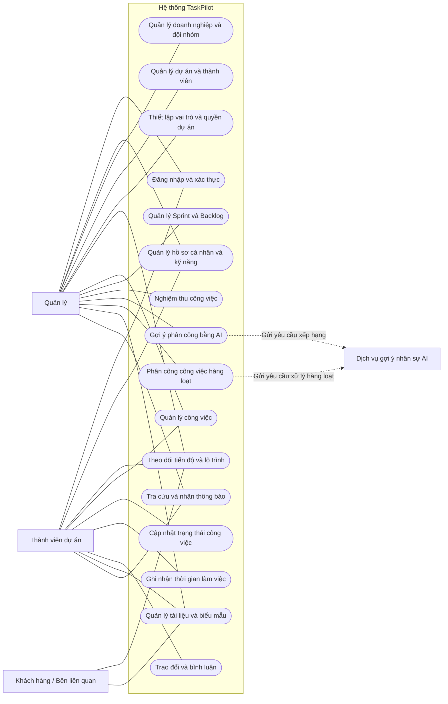

### 3.2. Sơ đồ Use Case phân rã theo nhóm chức năng

Các sơ đồ phân rã trình bày rõ hơn những thao tác thuộc từng nhóm nghiệp vụ. Phạm vi quyền thực hiện mỗi thao tác còn phụ thuộc vào vai trò và quyền được cấp cho người dùng trong dự án.

#### 3.2.1. Quản lý dự án, thành viên và phân quyền

Nhóm chức năng này hỗ trợ tạo và cập nhật dự án, quản lý thành viên, thiết lập vai trò và theo dõi tiến độ. Việc cấu hình quyền được thực hiện bởi Quản lý.

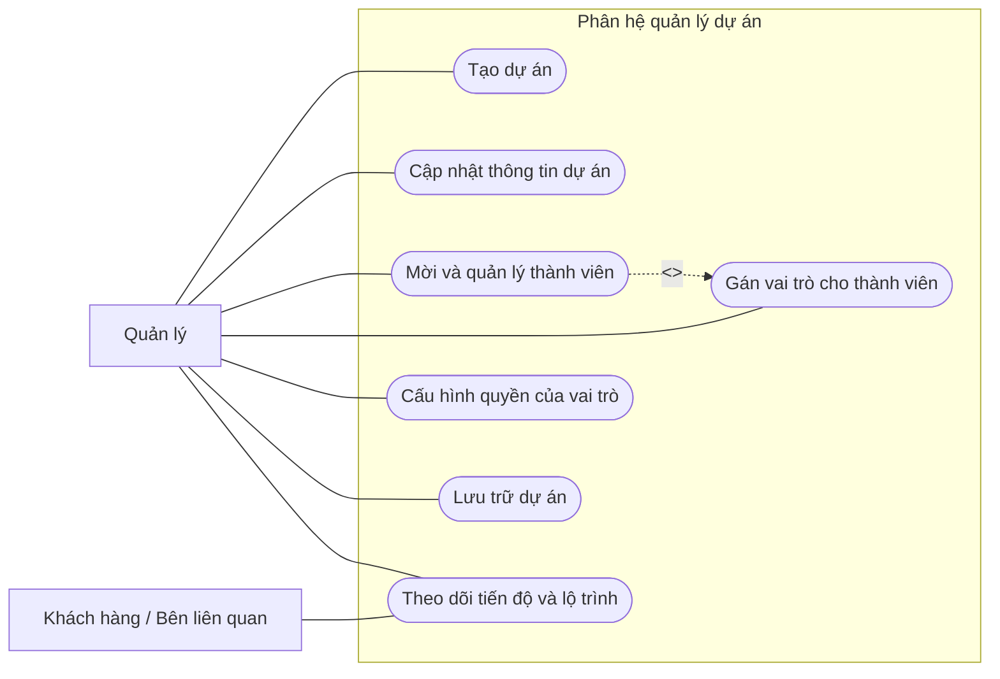

#### 3.2.2. Quản lý công việc, Sprint và Kanban

Nhóm chức năng này mô tả quá trình tạo công việc, lập kế hoạch Sprint, cập nhật trạng thái, ghi nhận thời gian làm việc và nghiệm thu. Việc chuyển trạng thái phải tuân theo quy trình được cấu hình và quyền của người thực hiện.

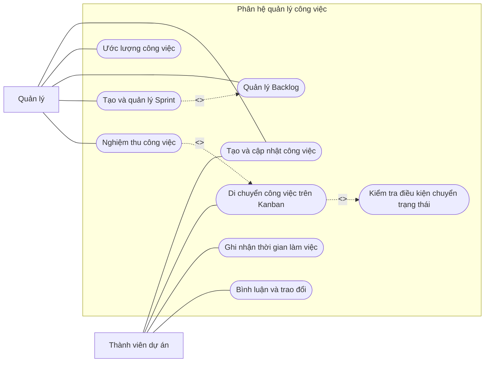

#### 3.2.3. Gợi ý phân công công việc bằng AI

Nhóm chức năng này hỗ trợ người quản lý tham khảo gợi ý nhân sự dựa trên thông tin công việc, kỹ năng và tải công việc hiện tại. Kết quả AI có tính chất hỗ trợ ra quyết định; người quản lý vẫn có thể chọn nhân sự khác hoặc phân công thủ công.

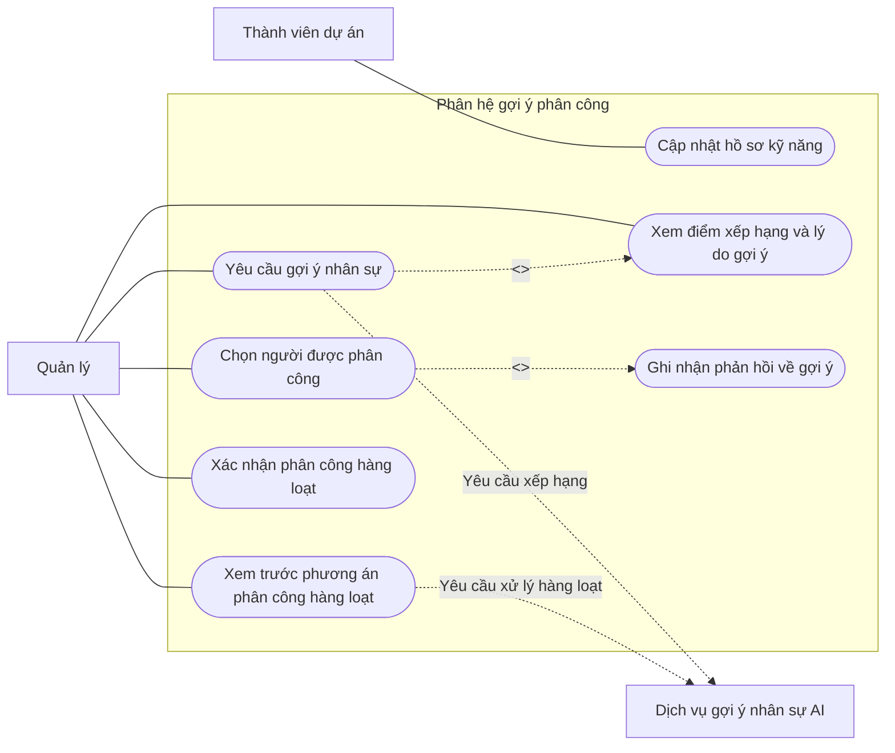

### 3.3. Nhận xét về mô hình Use Case

Sơ đồ tổng thể cung cấp cái nhìn khái quát về các chức năng chính của TaskPilot, trong khi các sơ đồ phân rã làm rõ thao tác của từng nhóm nghiệp vụ. Các mối quan hệ `<<include>>` và `<<extend>>` chỉ được sử dụng khi phản ánh đúng luồng xử lý: hành vi bắt buộc được mô hình hóa bằng `include`, còn hành vi phát sinh có điều kiện được mô hình hóa bằng `extend`. Các chức năng như quản lý tài liệu, biểu mẫu, thông báo và tra cứu vẫn thuộc phạm vi hệ thống; khi cần đặc tả chi tiết, có thể bổ sung sơ đồ riêng cho từng nhóm.


---

## CHƯƠNG 4: MÔ HÌNH HÓA ĐỘNG (DYNAMIC MODELING)


### 4.1. Biểu đồ Hoạt động (Activity Diagrams)


#### 4.1.1. Luồng Hoạt động Vòng đời Sprint (Sprint Lifecycle Workflow)


```mermaid

stateDiagram-v2

&#x20;   [*] --> Backlog_Planning: Thu thập Yêu cầu & Tạo Tasks



&#x20;   state Backlog_Planning {

&#x20;       [*] --> Create_Tasks

&#x20;       Create_Tasks --> Estimate_StoryPoints: Đánh giá độ phức tạp

&#x20;       Estimate_StoryPoints --> Select_Sprint_Scope: Chọn công việc vào Sprint

&#x20;   }



&#x20;   Backlog_Planning --> Sprint_Active: Nhấn 'Start Sprint' (Xác định Ngày Bắt đầu & Kết thúc)



&#x20;   state Sprint_Active {

&#x20;       [*] --> Open_Column

&#x20;       Open_Column --> In_Progress: Dev nhận việc & Bắt đầu làm

&#x20;       In_Progress --> Log_Work: Ghi nhận giờ làm (Worklogs)

&#x20;       Log_Work --> In_Progress

&#x20;       In_Progress --> Under_Review: Đẩy mã nguồn & Yêu cầu duyệt

&#x20;       Under_Review --> Review_Approval: Trưởng nhóm / Thành viên tiến hành review

&#x20;       Review_Approval --> Changes_Requested: Yêu cầu sửa đổi hoàn thiện

&#x20;       Changes_Requested --> In_Progress: Tiếp tục chỉnh sửa

&#x20;       Review_Approval --> Passed_Done: Nghiệm thu thành công (Approved)

&#x20;   }



&#x20;   Sprint_Active --> Sprint_Review_Closing: Hết thời gian Sprint / Nhấn 'Close Sprint'



&#x20;   state Sprint_Review_Closing {

&#x20;       [*] --> Audit_Incomplete_Tasks

&#x20;       Audit_Incomplete_Tasks --> Move_To_Next_Sprint: Dồn task dang dở sang Sprint mới

&#x20;       Audit_Incomplete_Tasks --> Move_To_Backlog: Đưa task dang dở về Backlog

&#x20;       Move_To_Next_Sprint --> Finalize_Report: Xuất báo cáo Burndown / Velocity

&#x20;       Move_To_Backlog --> Finalize_Report

&#x20;   }



&#x20;   Sprint_Review_Closing --> [*]: Hoàn tất Sprint

```


---


#### 4.1.2. Luồng Xử lý Gợi ý Phân bổ Ứng viên Thông minh bằng AI (Dual-Engine Pipeline)


```mermaid

flowchart TD

&#x20;   Start([Bắt đầu: Phát sinh yêu cầu gợi ý Task t]) --> ExtractContext[Trích xuất ngữ cảnh Task:\<br/>Tiêu đề, Mô tả, Component, Labels]

&#x20;   ExtractContext --> FetchCandidates[Truy vấn danh sách ứng viên thuộc Dự án:\<br/>Kỹ năng, Chức danh, Số task đang mở]

&#x20;   FetchCandidates --> CheckServiceStatus{Kiểm tra trạng thái\<br/>Dịch vụ AI Ngoại vi?}


&#x20;   %% Nhánh Chính: Machine Learning Ranker

&#x20;   CheckServiceStatus -- "Hoạt động bình thường" --> IPC_Request[Gửi HTTP/IPC Request sang Python Service]

&#x20;   IPC_Request --> FeatEngineering[Multi-Stream Feature Engineering:\<br/>TF-IDF N-grams cho Văn bản + Z-score cho Tải việc]

&#x20;   FeatEngineering --> LGBMRanker[Mô hình LightGBM LambdaMART Ranking:\<br/>Tính điểm liên quan thô s_i]

&#x20;   LGBMRanker --> Calibration[Hiệu chuẩn Độ tin cậy & Chuẩn hóa Điểm số:\<br/>p_i = Sigmoid s_i, quy đổi % tin cậy]

&#x20;   Calibration --> ExplainableAI[Bộ máy Giải trình Minh bạch XAI:\<br/>Bóc tách đóng góp đặc trưng -> Sinh lý do match_reasons]

&#x20;   ExplainableAI --> BuildResponse[Đóng gói JSON: Top 3 Ứng viên + % Tin cậy + Lý do]


&#x20;   %% Nhánh Dự phòng: Heuristic FastPath

&#x20;   CheckServiceStatus -- "Sự cố / Mất kết nối" --> FallbackEngine[Kích hoạt Heuristic FastPath nội bộ PHP Core]

&#x20;   FallbackEngine --> KeywordMatch[So khớp từ khóa Text với User Skills Matrix]

&#x20;   FallbackEngine --> WorkloadPenalty[Trừ điểm tải việc: penalty = active_tasks * 0.1]

&#x20;   KeywordMatch & WorkloadPenalty --> CalcFastScore[Tính FastPath Score = Skill_Overlap_Ratio - WorkloadPenalty]

&#x20;   CalcFastScore --> RankFast[Xếp hạng ứng viên theo FastPath Score]

&#x20;   RankFast --> BuildResponse


    BuildResponse --> DisplayUI[Hiển thị Modal Gợi ý trực quan trên giao diện]

    DisplayUI --> UserAction{Hành động của Quản lý?}

    UserAction -- "Chấp nhận Top 1 / Top k" --> SaveAssignee[Gán assignee_id vào Task & Ghi log accepted=true]

    UserAction -- "Tự chọn người khác" --> LogRejection[Ghi log accepted=false phục vụ Retraining]


    SaveAssignee --> End([Kết thúc])

    LogRejection --> End

```


---


### 4.2. Biểu đồ Tuần tự (Sequence Diagrams)

Các biểu đồ tuần tự dưới đây mô tả chi tiết tương tác theo thời gian giữa Tác nhân người dùng, Tầng Trình diễn (UI Vue 3/Blade), Tầng Điều khiển (Controllers), Tầng Ứng dụng (Handlers/DTOs), Tầng Dữ liệu (Repositories/Models) và các Dịch vụ phụ trợ (Mail, Notification, AI Engine).

#### 4.2.1. Biểu đồ Tuần tự Mời Thành viên vào Dự án (Invite Member to Project)

Biểu đồ mô tả quy trình Quản lý mời thêm nhân sự vào dự án thông qua email, kiểm tra trùng lặp, cấp vai trò, gửi email thư mời và phát thông báo hệ thống:

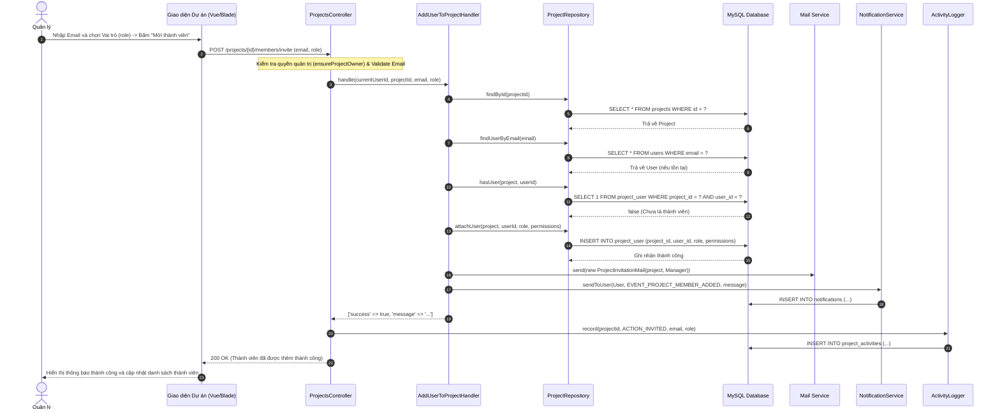

---

#### 4.2.2. Biểu đồ Tuần tự Thêm Công việc Mới (Create Task)

Biểu đồ mô tả quy trình khởi tạo công việc mới, kiểm tra trạng thái khởi tạo theo workflow của dự án, tự động sinh mã định danh (Issue Key: `TP-00xxx`) và đưa thẻ việc lên bảng Kanban:

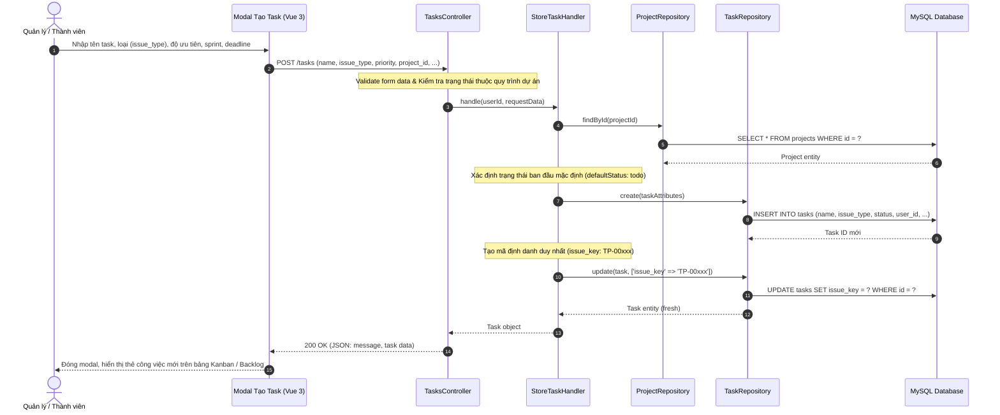

---

#### 4.2.3. Biểu đồ Tuần tự Chỉnh sửa / Cập nhật Công việc (Update Task)

Biểu đồ mô tả quy trình cập nhật nội dung công việc hoặc di chuyển thẻ Kanban, có sự tham gia của cổng kiểm tra quy trình (Workflow Gate Validator):

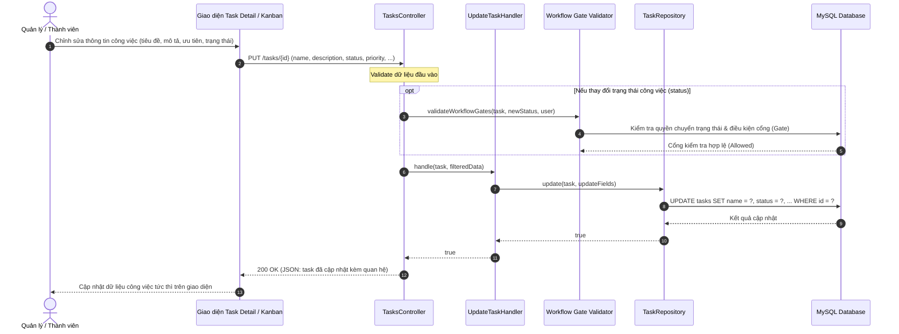

---

#### 4.2.4. Biểu đồ Tuần tự Phân công Công việc (Assign Task)

Biểu đồ mô tả quy trình Quản lý gán người thực hiện (Assignee) cho công việc, xác thực quyền hạn thông qua Policy và tự động gửi thông báo thời gian thực đến người được giao việc:

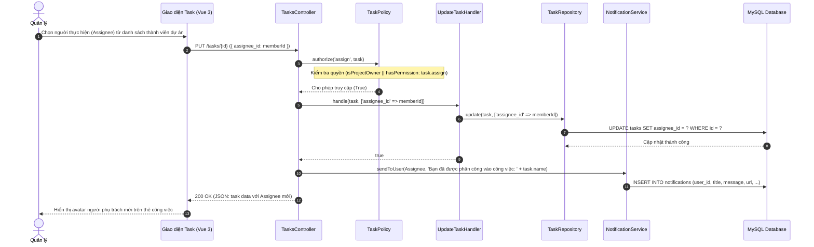

---

#### 4.2.5. Biểu đồ Tuần tự Bình luận và Trao đổi Công việc (Add Task Comment)

Biểu đồ mô tả quy trình người dùng gửi bình luận, gắn liên kết hoặc trao đổi thảo luận trên thẻ công việc (sử dụng quan hệ đa hình Polymorphic Commentable):

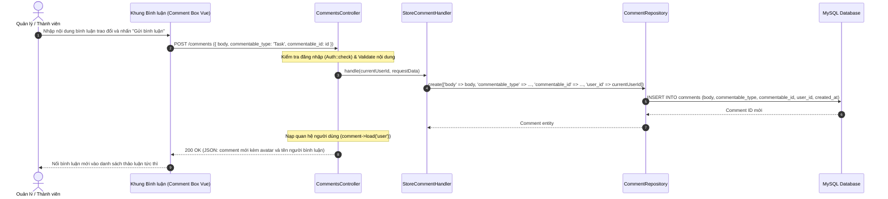

---

#### 4.2.6. Biểu đồ Tuần tự Phân công Công việc Thông minh Đơn lẻ qua AI (Single Task AI Recommendation)

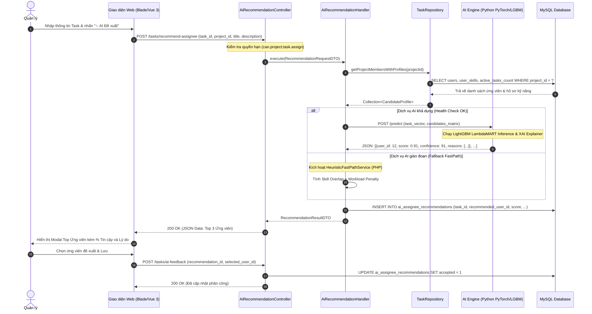

---

#### 4.2.7. Biểu đồ Tuần tự Phân công Hàng loạt Tự động qua AI trong Sprint (Batch AI Auto-Assignment Workflow)

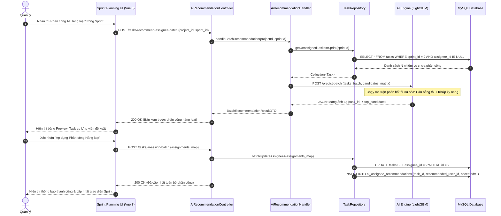


---


## CHƯƠNG 5: THIẾT KẾ KIẾN TRÚC PHẦN MỀM & MẪU THIẾT KẾ


### 5.1. Kiến trúc Phân tầng Modular Monolith (Strict Layered Architecture)


Hệ thống TaskPilot tuân thủ chặt chẽ nguyên tắc ****Phụ thuộc một chiều (Strict Unidirectional Dependency Flow)**** nhằm hạn chế sự phụ thuộc lỏng lẻo và phụ thuộc vòng:


$$\text{HTTP Request} \longrightarrow \text{Controller} \longrightarrow \text{Handler (Use Case)} \longrightarrow \text{Repository} \longrightarrow \text{Eloquent Model} \longrightarrow \text{MySQL Database}$$


```mermaid

graph TD

&#x20;   subgraph PresentationLayer ["1. TẦNG TRÌNH DIỄN (PRESENTATION LAYER)"]

&#x20;       BladeViews["Laravel Blade Templates (Layouts & Partials)"]

&#x20;       VueComponents["Vue 3 Interactive Components (Kanban, Sprints, AI Modal)"]

&#x20;       FormRequests["HTTP Form Requests (Validation & Authorization)"]

&#x20;   end


&#x20;   subgraph ApplicationLayer ["2. TẦNG ỨNG DỤNG (APPLICATION / USE CASE LAYER)"]

&#x20;       Controllers["Module Controllers (Dispatchers)"]

&#x20;       Handlers["Command Handlers / Use Case Actions\<br/>(CreateTaskHandler, StoreTaskHandler, etc.)"]

&#x20;       DTOs["Data Transfer Objects (DTOs)"]

&#x20;   end


&#x20;   subgraph DomainServiceLayer ["3. TẦNG DỊCH VỤ NGHIỆP VỤ (DOMAIN SERVICES)"]

&#x20;       AIServiceBridge["AI Recommendation Service / FastPath Bridge"]

&#x20;       WorkflowEngine["Workflow State Transition Engine"]

&#x20;       NotificationDispatcher["Multi-Channel Notification Dispatcher"]

&#x20;   end


&#x20;   subgraph PersistenceLayer ["4. TẦNG TRUY XUẤT DỮ LIỆU (PERSISTENCE LAYER)"]

&#x20;       Repositories["Module Repositories (TaskRepository, ProjectRepository)"]

&#x20;       EloquentModels["Domain Models (Task, Project, User, Sprint)"]

&#x20;   end


&#x20;   subgraph InfrastructureLayer ["5. TẦNG HẠ TẦNG (INFRASTRUCTURE LAYER)"]

&#x20;       DB[(MySQL 8.4 Enterprise)]

&#x20;       RedisStore[(Redis Cache & Queues)]

&#x20;       PythonInference["Python AI Ranker (PyTorch / LightGBM)"]

&#x20;   end


&#x20;   PresentationLayer --> ApplicationLayer

&#x20;   ApplicationLayer --> DomainServiceLayer

&#x20;   DomainServiceLayer --> PersistenceLayer

&#x20;   PersistenceLayer --> InfrastructureLayer


&#x20;   Controllers --> Handlers

&#x20;   Handlers --> DTOs

&#x20;   Handlers --> Repositories

&#x20;   Handlers --> DomainServiceLayer

&#x20;   Repositories --> EloquentModels

&#x20;   EloquentModels --> DB

&#x20;   AIServiceBridge --> PythonInference

```


---


### 5.2. Biểu đồ Lớp Chi tiết (Detailed Class Diagram)


Biểu đồ sau mô tả cấu trúc hướng đối tượng của phân hệ ****Tasks**** và phân hệ ****AI Recommendation****:


```mermaid

classDiagram

&#x20;   class TasksController {

&#x20;       -ListTasksHandler listHandler

&#x20;       -CreateTaskHandler createHandler

&#x20;       -StoreTaskHandler storeHandler

&#x20;       -UpdateTaskHandler updateHandler

&#x20;       -DeleteTaskHandler deleteHandler

&#x20;       +index(Request request) View

&#x20;       +create(Request request) View

&#x20;       +store(StoreTaskRequest request) RedirectResponse

&#x20;       +show(int id) View

&#x20;       +move(Request request, Task task) JsonResponse

&#x20;       +worklog(Request request, Task task) JsonResponse

&#x20;       +approve(Request request, Task task) JsonResponse

&#x20;   }


&#x20;   class AiRecommendationController {

&#x20;       -AiRecommendationHandler aiHandler

&#x20;       +recommend(Request request) JsonResponse

&#x20;       +recommendBatch(Request request) JsonResponse

&#x20;       +assignBatch(Request request) JsonResponse

&#x20;       +feedback(Request request) JsonResponse

&#x20;       +resetTestAssignments(Request request) JsonResponse

&#x20;   }


&#x20;   class StoreTaskHandler {

&#x20;       -TaskRepository taskRepo

&#x20;       -AiRecommendationHandler aiHandler

&#x20;       +handle(TaskDataDTO data) Task

&#x20;   }


&#x20;   class AiRecommendationHandler {

&#x20;       -TaskRepository taskRepo

&#x20;       -AiInferenceGateway aiGateway

&#x20;       -FastPathFallbackService fallbackService

&#x20;       +getRecommendations(int taskId, int projectId) Collection

&#x20;       +batchAssign(int projectId, int sprintId) BatchResultDTO

&#x20;   }


&#x20;   class TaskRepository {

&#x20;       <\<interface>>

&#x20;       +findById(int id) Task

&#x20;       +findByProject(int projectId) Collection

&#x20;       +store(array data) Task

&#x20;       +updateStatus(int taskId, string status, int order) bool

&#x20;       +getEligibleMembersWithSkills(int projectId) Collection

&#x20;   }


&#x20;   class Task {

&#x20;       +int id

&#x20;       +string name

&#x20;       +string issue_key

&#x20;       +string description

&#x20;       +string status

&#x20;       +string priority

&#x20;       +int project_id

&#x20;       +int user_id

&#x20;       +int assignee_id

&#x20;       +int sprint_id

&#x20;       +float story_points

&#x20;       +date due_date

&#x20;       +project() BelongsTo

&#x20;       +assignee() BelongsTo

&#x20;       +reporter() BelongsTo

&#x20;       +sprint() BelongsTo

&#x20;       +worklogs() HasMany

&#x20;       +comments() HasMany

&#x20;       +skills() BelongsToMany

&#x20;   }


&#x20;   class AiAssigneeRecommendation {

&#x20;       +int id

&#x20;       +int task_id

&#x20;       +int recommended_user_id

&#x20;       +float score

&#x20;       +float confidence_percentage

&#x20;       +json match_reasons

&#x20;       +bool accepted

&#x20;       +datetime created_at

&#x20;   }


&#x20;   TasksController --> StoreTaskHandler : utilizes

&#x20;   TasksController --> TaskRepository : queries

&#x20;   AiRecommendationController --> AiRecommendationHandler : utilizes

&#x20;   StoreTaskHandler --> TaskRepository : persists

&#x20;   StoreTaskHandler --> AiRecommendationHandler : optionally invokes

&#x20;   AiRecommendationHandler --> TaskRepository : reads members & tasks

&#x20;   TaskRepository --> Task : hydrates

&#x20;   AiRecommendationHandler --> AiAssigneeRecommendation : records

&#x20;   Task "1" *-- "0..*" AiAssigneeRecommendation : history

```


---


### 5.3. Các Mẫu Thiết kế Áp dụng (Design Patterns Applied)


1. ****Repository Pattern****:

&#x20;  * **Mục đích**: Tách rời logic nghiệp vụ khỏi tầng truy xuất cơ sở dữ liệu (Eloquent ORM). Cho phép dễ dàng viết Unit Test bằng cách Mock Repository mà không cần chạm vào CSDL thật.

&#x20;  * **Hiện thực**: `TaskRepository`, `ProjectRepository`.


2. ****Command / Single Action Handler Pattern****:

&#x20;  * **Mục đích**: Tránh tình trạng "Fat Controller" phổ biến trong các dự án web. Mỗi Use Case được đóng gói vào một Class Handler chuyên biệt (`StoreTaskHandler`, `ListTasksHandler`, `CreateTaskHandler`), chịu trách nhiệm validate logic nghiệp vụ phức tạp.


3. ****Strategy & Fallback Pattern (Dual-Engine AI)****:

&#x20;  * **Mục đích**: Đảm bảo tính khả dụng cao (High Availability). Khi gọi dịch vụ Machine Learning qua mạng, nếu gặp timeout hoặc ngoại lệ, hệ thống tự động tráo đổi Strategy sang thuật toán Heuristic nội bộ mà không làm sập tiến trình tạo task của người dùng.


4. ****Observer & Event-Driven Architecture (EDA)****:

&#x20;  * **Mục đích**: Tách rời các tác vụ phụ (gửi email, push notification, ghi activity log) ra khỏi luồng nghiệp vụ chính. Khi thẻ Kanban thay đổi trạng thái, `TaskObserver` tự động bắt sự kiện và phát tín hiệu cho các listener xử lý ngầm (Asynchronous Queue Workers).


5. ****Multi-Level Role-Based Access Control (RBAC)****:

&#x20;  * **Mục đích**: Quản lý quyền hạn đa tầng. Người dùng có vai trò toàn cục (System Role: Admin/User), đồng thời có vai trò riêng biệt trong từng dự án cụ thể (Project Role: Project Manager, Lead, Member, Viewer) với danh mục 25+ permissions chi tiết được định nghĩa tại `ProjectRoleConstants`.


---


## CHƯƠNG 6: THIẾT KẾ CƠ SỞ DỮ LIỆU TOÀN DIỆN


### 6.1. Sơ đồ Thực thể Quan hệ (Conceptual & Logical ERD)


```mermaid

erDiagram

&#x20;   USERS ||--o{ COMPANIES : "created_by"

&#x20;   USERS ||--o{ PROJECTS : "owns / project_manager"

&#x20;   USERS ||--o{ PROJECT_USER : "participates_in"

&#x20;   PROJECTS ||--o{ PROJECT_USER : "has_members"

&#x20;   PROJECT_ROLES ||--o{ PROJECT_USER : "assigned_to"

&#x20;   PROJECTS ||--o{ PROJECT_ROLES : "defines"

&#x20;   COMPANIES ||--o{ PROJECTS : "sponsors / client_of"

&#x20;   PROJECT_CATEGORIES ||--o{ PROJECTS : "categorizes"

&#x20;   TEAMS ||--o{ PROJECTS : "executes"

&#x20;   TEAMS ||--o{ TEAM_USER : "includes"

&#x20;   USERS ||--o{ TEAM_USER : "belongs_to"


&#x20;   PROJECTS ||--o{ SPRINTS : "contains"

&#x20;   PROJECTS ||--o{ TASKS : "tracks"

&#x20;   SPRINTS ||--o{ TASKS : "schedules"

&#x20;   USERS ||--o{ TASKS : "reported_by (user_id)"

&#x20;   USERS ||--o{ TASKS : "assigned_to (assignee_id)"

&#x20;   TASKS ||--o{ WORKLOGS : "logs_effort"

&#x20;   USERS ||--o{ WORKLOGS : "logged_by"


&#x20;   TASKS ||--o{ COMMENTS : "has"

&#x20;   USERS ||--o{ COMMENTS : "wrote"


&#x20;   USERS ||--o{ USER_SKILLS : "possesses"

&#x20;   TASKS ||--o{ TASK_SKILLS : "requires"


&#x20;   TASKS ||--o{ AI_ASSIGNEE_RECOMMENDATIONS : "evaluated_by"

&#x20;   USERS ||--o{ AI_ASSIGNEE_RECOMMENDATIONS : "recommended_user"


&#x20;   PROJECTS ||--o{ PROJECT_ACTIVITIES : "logs"

&#x20;   PROJECTS ||--o{ PROJECT_DOCUMENTS : "manages"

&#x20;   PROJECTS ||--o{ PROJECT_FORMS : "collects"

&#x20;   USERS ||--o{ NOTIFICATIONS : "receives"

```


---


### 6.2. Từ điển Dữ liệu Chi tiết Các Thực thể Cốt lõi (Data Dictionary)


#### 6.2.1. Thực thể `users` (Tài khoản Người dùng)

Bảng lưu trữ danh tính người dùng trong toàn hệ thống:


| Tên Cột | Kiểu Dữ Liệu | Ràng Buộc | Mô Tả |

| :--- | :--- | :--- | :--- |

| `id` | `BIGINT UNSIGNED` | PK, Auto Increment | Định danh duy nhất của người dùng. |

| `name` | `VARCHAR(255)` | NOT NULL | Họ và tên đầy đủ. |

| `email` | `VARCHAR(255)` | UNIQUE, NOT NULL, Index | Địa chỉ thư điện tử dùng để đăng nhập. |

| `password` | `VARCHAR(255)` | NULLABLE | Mật khẩu băm (Bcrypt hash); rỗng nếu dùng OAuth. |

| `role_id` | `INT UNSIGNED` | NOT NULL, Default: 2 | Vai trò cấp hệ thống (1: Admin, 2: Member). |

| `designation` | `VARCHAR(100)` | NULLABLE | Chức danh chuyên môn (VD: Senior Backend Engineer). |

| `phone` | `VARCHAR(50)` | NULLABLE | Số điện thoại liên hệ. |

| `avatar` | `VARCHAR(255)` | NULLABLE | Đường dẫn ảnh đại diện. |

| `google_id` | `VARCHAR(255)` | NULLABLE, Index | Mã định danh Google OAuth khi đăng nhập SSO. |

| `created_at` | `TIMESTAMP` | NULLABLE | Thời điểm khởi tạo tài khoản. |


#### 6.2.2. Thực thể `projects` (Dự án Quản lý)

Bảng lưu trữ thông tin các dự án công nghệ:


| Tên Cột | Kiểu Dữ Liệu | Ràng Buộc | Mô Tả |

| :--- | :--- | :--- | :--- |

| `id` | `BIGINT UNSIGNED` | PK, Auto Increment | Khóa chính của dự án. |

| `name` | `VARCHAR(255)` | NOT NULL | Tên dự án (VD: TaskPilot Enterprise). |

| `project_code` | `VARCHAR(50)` | UNIQUE, Index | Mã viết tắt tiền tố của task (VD: `PILOT`). |

| `description` | `TEXT` | NULLABLE | Mô tả mục tiêu và phạm vi dự án. |

| `company_id` | `BIGINT UNSIGNED` | FK -> companies(id), NULLABLE | Doanh nghiệp đối tác chủ quản. |

| `user_id` | `BIGINT UNSIGNED` | FK -> users(id), NOT NULL | Người tạo dự án (Project Owner). |

| `team_id` | `BIGINT UNSIGNED` | FK -> teams(id), NULLABLE | Nhóm phụ trách chính. |

| `status` | `ENUM` | Default: 'active' | Trạng thái: `active`, `on_hold`, `completed`, `archived`. |

| `budget` | `DECIMAL(12,2)` | NULLABLE | Ngân sách dự toán của dự án. |

| `start_date` | `DATE` | NULLABLE | Ngày bắt đầu dự án. |

| `end_date` | `DATE` | NULLABLE | Ngày kết thúc dự toán. |


#### 6.2.3. Thực thể `tasks` (Công việc & Thẻ Kanban)

Thực thể trung tâm quản lý toàn bộ các nhiệm vụ:


| Tên Cột | Kiểu Dữ Liệu | Ràng Buộc | Mô Tả |

| :--- | :--- | :--- | :--- |

| `id` | `BIGINT UNSIGNED` | PK, Auto Increment | Khóa chính của nhiệm vụ. |

| `name` | `VARCHAR(255)` | NOT NULL | Tiêu đề tóm tắt của công việc. |

| `issue_key` | `VARCHAR(60)` | UNIQUE, Index | Khóa định danh công việc (VD: `PILOT-101`). |

| `description` | `LONGTEXT` | NULLABLE | Nội dung mô tả kỹ thuật chi tiết. |

| `project_id` | `BIGINT UNSIGNED` | FK -> projects(id), Index | Dự án sở hữu task. |

| `user_id` | `BIGINT UNSIGNED` | FK -> users(id) | Người tạo task (Reporter). |

| `assignee_id` | `BIGINT UNSIGNED` | FK -> users(id), NULLABLE, Index | Người được phân công thực hiện. |

| `sprint_id` | `BIGINT UNSIGNED` | FK -> sprints(id), NULLABLE, Index | Sprint chứa task (NULL = nằm ở Backlog). |

| `status` | `VARCHAR(50)` | Default: 'open', Index | Trạng thái: `open`, `in_progress`, `review`, `done`, `closed`. |

| `priority` | `VARCHAR(50)` | Default: 'medium' | Độ ưu tiên: `lowest`, `low`, `medium`, `high`, `highest`. |

| `story_points` | `DECIMAL(4,1)` | NULLABLE | Điểm ước lượng độ phức tạp Scrum. |

| `order` | `INT` | Default: 0 | Thứ tự hiển thị trong cột Kanban. |

| `due_date` | `DATE` | NULLABLE | Hạn chót hoàn thành. |


#### 6.2.4. Thực thể `ai_assignee_recommendations` (Nhật ký Gợi ý AI)

Lưu trữ toàn bộ lịch sử suy luận, giải trình và phản hồi của người dùng:


| Tên Cột | Kiểu Dữ Liệu | Ràng Buộc | Mô Tả |

| :--- | :--- | :--- | :--- |

| `id` | `BIGINT UNSIGNED` | PK, Auto Increment | Khóa chính bản ghi gợi ý. |

| `task_id` | `BIGINT UNSIGNED` | FK -> tasks(id), Index | Nhiệm vụ được gợi ý. |

| `recommended_user_id`| `BIGINT UNSIGNED` | FK -> users(id) | Nhân sự được AI khuyến nghị. |

| `score` | `FLOAT` | NOT NULL | Điểm số tương thích chuẩn hóa $[0.0, 1.0]$. |

| `confidence_percentage`| `FLOAT` | NOT NULL | Độ tin cậy quy đổi phần trăm $[0\\%, 100\\%]$. |

| `match_reasons` | `JSON` | NULLABLE | Mảng các lý do giải trình XAI bằng tiếng Việt. |

| `accepted` | `TINYINT(1)` | NULLABLE | Phản hồi của Quản lý (1: Chấp nhận, 0: Bỏ qua). |

| `created_at` | `TIMESTAMP` | NOT NULL | Thời điểm gợi ý. |


---


### 6.3. Ràng buộc Toàn vẹn & Chiến lược Chỉ mục Tối ưu (Indexing Strategy)


Để bảo đảm hiệu năng truy vấn tức thì ($< 50\text{ ms}$) trong điều kiện bảng `tasks` đạt hàng triệu bản ghi, hệ thống áp dụng các chỉ mục phức hợp (Composite Indexes) sau:


```sql

-- 1. Tối ưu hóa truy vấn bảng Kanban: Lọc theo Dự án + Trạng thái + Thứ tự sắp xếp

CREATE INDEX idx_tasks_project_status_order&#x20;

ON tasks (project_id, status, `order`);


-- 2. Tối ưu hóa truy vấn "Công việc của tôi" (My Tasks) & Kiểm tra hạn chót

CREATE INDEX idx_tasks_assignee_status_due&#x20;

ON tasks (assignee_id, status, due_date);


-- 3. Tối ưu hóa truy vấn công việc trong Sprint hiện hành

CREATE INDEX idx_tasks_sprint_status&#x20;

ON tasks (sprint_id, status);


-- 4. Tối ưu tra cứu mã thẻ duy nhất (PILOT-123)

CREATE UNIQUE INDEX uq_tasks_issue_key&#x20;

ON tasks (issue_key);


-- 5. Tối ưu truy vấn lịch sử gợi ý AI theo Task

CREATE INDEX idx_ai_rec_task_score&#x20;

ON ai_assignee_recommendations (task_id, score DESC);

```


---


## CHƯƠNG 7: THIẾT KẾ GIAO DIỆN & TRẢI NGHIỆM NGƯỜI DÙNG (UI/UX)


### 7.1. Cây Sơ đồ Điều hướng Hệ thống (Site Navigation Map)


```mermaid

graph TD

&#x20;   Root["TaskPilot Platform Portal"]

&#x20;   Root --> Auth["Xác thực (Login / Register / Google SSO)"]

&#x20;   Root --> Dashboard["Bảng Điều Khiển Tổng Quan (Home)"]

&#x20;   Dashboard --> QuickSearch["Tìm kiếm Nhanh Toàn cục (Ctrl + K)"]

&#x20;   Dashboard --> Profile["Hồ sơ Cá nhân & Kỹ năng (Skills Matrix)"]

&#x20;   Dashboard --> Notifications["Trung tâm Thông báo Đa kênh"]

&#x20;   Dashboard --> ProjectsMod["Quản lý Dự án (Projects)"]

&#x20;   ProjectsMod --> ProjDetail["Chi tiết Dự án"]

&#x20;   ProjDetail --> Kanban["Bảng Kanban Kéo thả Tương tác"]

&#x20;   ProjDetail --> Sprints["Quản lý Sprint & Backlog"]

&#x20;   ProjDetail --> Timeline["Dòng thời gian (Timeline / Gantt)"]

&#x20;   ProjDetail --> Members["Quản lý Thành viên & Phân quyền RBAC"]

&#x20;   ProjDetail --> Documents["Kho Tài liệu Số & Biểu mẫu"]

&#x20;   Dashboard --> CompaniesMod["Quản lý Doanh nghiệp Khách hàng"]

&#x20;   Dashboard --> TeamsMod["Quản lý Đội nhóm Kỹ thuật"]

```


---


### 7.2. Đặc tả Bố cục Màn hình Trọng yếu


#### 7.2.1. Bảng Kanban Quản trị Công việc (Interactive Kanban Board)

* ****Khu vực Header Bảng****: Hiển thị tên dự án, bộ lọc nhanh theo Sprint, bộ lọc theo thành viên phụ trách (Assignee Avatar list), ô tìm kiếm từ khóa và nút ****"✨ Phân công AI Hàng loạt"**** cùng nút ****"Tạo Task"****.

* ****Các Cột Trạng thái****: Gồm 5 cột mặc định:

&#x20; 1. `Open`: Công việc mới tiếp nhận, chưa bắt đầu.

&#x20; 2. `In Progress`: Công việc đang được lập trình viên triển khai.

&#x20; 3. `Review`: Công việc đã hoàn thành mã nguồn, đang chờ kiểm duyệt code hoặc nghiệm thu.

&#x20; 4. `Done`: Công việc đã hoàn thành và được phê duyệt (Approved).

&#x20; 5. `Closed`: Công việc đã nghiệm thu và đóng hoàn toàn.

* ****Thẻ Công việc (Task Card)****: Hiển thị Mã thẻ (`PILOT-101`), Tiêu đề, Badge Mức độ ưu tiên (màu sắc trực quan: Highest - Đỏ đậm, High - Cam, Medium - Vàng, Low - Xanh lam), Story Points, Avatar người thực hiện và nút thao tác nhanh.


#### 7.2.2. Modal Gợi ý Nhân sự Thông minh bằng AI (AI Recommendation Modal)

* ****Phần đầu (Header)****: Huy hiệu biểu tượng AI rực rỡ với tiêu đề: **"Đề xuất Nhân sự Tối ưu bằng Trí tuệ Nhân tạo"**.

* ****Danh sách Ứng viên Xếp hạng****:

&#x20; * Mỗi ứng viên được hiển thị dưới dạng một thẻ tương tác với thanh tiến trình đo độ tin cậy (`Progress Bar` từ $0\\%$ đến $100\\%$).

&#x20; * Nhãn phân tầng hành động:

&#x20;   * ****Top 1****: Huy hiệu xanh lá `Khuyến nghị nhận việc cao nhất` (Primary Assignee).

&#x20;   * ****Top 2 & 3****: Huy hiệu xanh dương `Ứng viên dự phòng an toàn`.

&#x20; * Khối giải trình minh bạch (XAI Match Reasons): Liệt kê danh sách các gạch đầu dòng giải thích lý do:

&#x20;   * **"Khớp 3/3 kỹ năng trọng yếu: Laravel, Redis, MySQL."**

&#x20;   * **"Đã hoàn thành 5 task tương tự trong cùng module với hiệu suất cao."**

&#x20;   * **"Tải công việc hiện tại an toàn (chỉ đang phụ trách 1 task đang mở)."**

* ****Thao tác****: Nhấn chọn ứng viên để tự động gán vào task, hoặc nhấn nút ****"Chấp nhận Phân công"****.


---


### 7.3. Hệ thống Quy chuẩn Giao diện (Design System Tokens)


Giao diện TaskPilot áp dụng phong cách thiết kế hiện đại, kết hợp giữa ****Clean Enterprise Design**** và phong cách ****Glassmorphism****:


* ****Bảng màu Chủ đạo (Curated Palette)****:

&#x20; * Màu Nhận diện Thương hiệu (Primary): `Indigo 600` (`#4F46E5`) và `Blue 600` (`#2563EB`).

&#x20; * Trạng thái Thành công (Success / Top 1 AI): `Emerald 500` (`#10B981`).

&#x20; * Trạng thái Cảnh báo / Quá tải: `Amber 500` (`#F59E0B`).

&#x20; * Trạng thái Khẩn cấp (Highest Priority): `Rose 600` (`#E11D48`).

&#x20; * Nền Chế độ Tối (Dark Surface): `Slate 900` (`#0F172A`) kết hợp `Slate 800` (`#1E293B`).

* ****Kiểu chữ (Typography)****:

&#x20; * Phông chữ chuẩn: ****Inter**** và ****Outfit**** từ Google Fonts, tối ưu khả năng hiển thị văn bản kỹ thuật và số liệu.

* ****Hiệu ứng & Micro-animations****:

&#x20; * Chuyển động thẻ Kanban mượt mà với thư viện SortableJS / Vue Draggable (`transition: all 0.2s cubic-bezier(0.4, 0, 0.2, 1)`).

&#x20; * Hiệu ứng vầng sáng gradient (Glow Pulse) cho các đề xuất do AI sinh ra.


---


## CHƯƠNG 8: MA TRẬN TRUY VẾT & KẾT LUẬN


### 8.1. Ma trận Truy vết Yêu cầu sang Mã nguồn (Traceability Matrix)


Ma trận chứng minh sự nhất quán hoàn hảo giữa Phân tích Yêu cầu, Thiết kế Kỹ thuật và Cài đặt Thực tế trong mã nguồn:


| Mã Yêu Cầu | Tên Chức Năng | Controller & Handler Phụ Trách | Models & Bảng CSDL Liên Quan |

| :--- | :--- | :--- | :--- |

| ****FR-01**** | Xác thực & Skills | `ProfileController`, `SkillsController` | `User`, `UserSkill`, `Skill` (`users`, `user_skills`) |

| ****FR-02**** | Doanh nghiệp & Đội nhóm | `CompaniesController`, `TeamsController` | `Company`, `Team`, `TeamUser` (`companies`, `teams`) |

| ****FR-03**** | Dự án & Phân quyền RBAC | `ProjectsController`, `can.project` Gate | `Project`, `ProjectRole`, `ProjectPermission` |

| ****FR-04**** | Tasks, Kanban & Sprints | `TasksController`, `SprintsController`, `StoreTaskHandler` | `Task`, `Sprint`, `Worklog`, `Comment` (`tasks`, `sprints`) |

| ****FR-05**** | Trợ lý Gợi ý Phân công AI | `AiRecommendationController`, `AiRecommendationHandler` | `AiAssigneeRecommendation` (`ai_assignee_recommendations`) |

| ****FR-06**** | Tài liệu & Biểu mẫu | `ProjectDocumentsController`, `ProjectFormsController` | `ProjectDocument`, `ProjectForm`, `ProjectFormResponse` |

| ****FR-07**** | Thông báo & QuickSearch | `NotificationController`, `QuickSearchController` | `Notification`, `ProjectActivity` (`notifications`) |


---


### 8.2. Kết luận và Đánh giá Tính Khả thi


Tài liệu ****Phân tích và Thiết kế Hệ thống TaskPilot**** đã thiết lập đầy đủ khung tham chiếu kỹ thuật toàn diện cho toàn bộ nền tảng:

1. ****Tính Đúng đắn & Tính Nhất quán****: Mọi mô hình Use Case, Biểu đồ Tuần tự, Biểu đồ Hoạt động và Sơ đồ ERD đều khớp chính xác với cấu trúc cơ sở dữ liệu và mã nguồn đang vận hành trong dự án TaskPilot.

2. ****Khả năng Mở rộng Cao****: Kiến trúc phân tầng Modular Monolith cho phép hệ thống vận hành tinh gọn trong giai đoạn hiện tại, đồng thời có ranh giới rõ ràng giữa các Domain Context để sẵn sàng phân tách thành Microservices độc lập trong tương lai.

3. ****Đột phá về Ứng dụng AI****: Việc tích hợp bộ máy Machine Learning (Learning to Rank - LightGBM) có khả năng giải trình minh bạch (XAI) vào lõi quản trị Agile đưa TaskPilot trở thành nền tảng quản lý dự án thế hệ mới, vượt trội so với các công cụ truyền thống trên thị trường.


---


```text

\========================================================================================

&#x20;                           TASKPILOT SYSTEM SPECIFICATION

&#x20;                 © 2026 TaskPilot Engineering Team. All Rights Reserved.

\========================================================================================

```