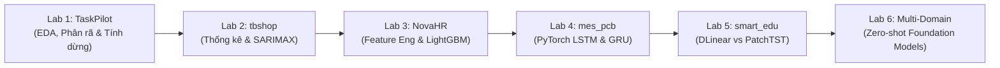

# LỘ TRÌNH 6 LABS THỰC HÀNH CHUỖI THỜI GIAN (TIME SERIES FORECASTING)
> **Định hướng**: Áp dụng kỹ thuật và toán học chuỗi thời gian từ cơ bản đến SOTA (State-of-the-Art) vào trực tiếp các bài toán nghiệp vụ trong hệ sinh thái sản phẩm (`TaskPilot`, `tbshop`, `NovaHR`, `mes_pcb`, `smart_edu`).

---

## 📌 Tổng quan Lộ trình 6 Labs



---

### 🧪 Lab 1: EDA, Phân rã dữ liệu & Kiểm định tính dừng (Stationarity)
*Nền tảng cốt lõi: Phân tích cấu trúc dữ liệu và xử lý tính dừng trước khi đưa vào bất kỳ mô hình dự báo nào.*

* **Bối cảnh & Dữ liệu (`TaskPilot`)**: 
  * Chuỗi thời gian số lượng **Bug / Task phát sinh hàng ngày** trong các dự án phần mềm (`daily_bug_reports.csv` / export từ database TaskPilot).
  * Đặc thù nghiệp vụ: Có tính mùa vụ theo tuần rất mạnh (đỉnh điểm vào Thứ Hai/Thứ Ba, chạm đáy vào cuối tuần) và các đợt bùng phát (spikes) vào ngày Release/Sprint Review.
* **Yêu cầu kỹ thuật & Toán học**:
  * **Phân rã chuỗi (Decomposition)**: Phân tách thành **Trend** (Xu hướng), **Seasonality** (Mùa vụ với chu kỳ $s=7$ ngày), và **Residual** (Nhiễu ngẫu nhiên) bằng mô hình cộng (Additive) và mô hình nhân (Multiplicative).
  * **Phân tích tương quan**: Vẽ biểu đồ hàm tự tương quan (**ACF**) và hàm tự tương quan riêng phần (**PACF**) để nhận diện độ trễ mùa vụ và bậc tự hồi quy.
  * **Kiểm định tính dừng (Stationarity Tests)**: 
    * Kiểm định **ADF** (Augmented Dickey-Fuller - giả thuyết $H_0$: chuỗi có nghiệm đơn vị/không dừng).
    * Kiểm định **KPSS** (Kwiatkowski-Phillips-Schmidt-Shin - giả thuyết $H_0$: chuỗi dừng xung quanh xu hướng).
  * **Biến đổi làm dừng chuỗi**: Sai phân bậc 1 ($y_t - y_{t-1}$), sai phân mùa vụ tuần ($y_t - y_{t-7}$), phép biến đổi Log và Box-Cox khi phương sai thay đổi theo thời gian.
* **Thư viện chính**: `pandas`, `numpy`, `statsmodels`, `matplotlib`, `seaborn`.
* **Kết quả cần đạt**: Notebook EDA hoàn chỉnh, tự động kết luận chuỗi có dừng hay không, xác định chu kỳ mùa vụ và trực quan hóa các thành phần phân rã.

---

### 🧪 Lab 2: Các mô hình thống kê cổ điển & Dự báo có biến ngoại sinh
*Học cách xây dựng baseline chuẩn mực và hiểu cơ chế dự báo thống kê khi có yếu tố can thiệp từ bên ngoài.*

* **Bối cảnh & Dữ liệu (`tbshop` / `excavator`)**:
  * Chuỗi thời gian **Số lượng đơn hàng & Nhu cầu sản phẩm theo ngày** (`daily_orders_demand.csv`).
  * Có yếu tố ngoại sinh: Ngày chạy chiến dịch Flash Sale (`is_flash_sale`), mã giảm giá trên 10% (`discount_rate`), và ngày lễ mua sắm.
* **Yêu cầu kỹ thuật & Toán học**:
  * **Mô hình cơ sở (Baselines)**: Naive forecast (lấy giá trị ngày trước), Seasonal Naive (lấy giá trị cùng kỳ tuần trước), Trung bình trượt (Moving Average), San bằng mũ (Holt-Winters Exponential Smoothing).
  * **Họ mô hình ARIMA & SARIMA**:
    * Hiểu rõ cơ chế tự hồi quy $AR(p)$, sai phân tích hợp $I(d)$, trung bình trượt nhiễu $MA(q)$.
    * Mở rộng mùa vụ **SARIMA** $(p,d,q)(P,D,Q)_7$.
  * **Mô hình có biến ngoại sinh (SARIMAX)**: Đưa các biến tác động (Khuyến mãi, Giá giảm) vào phương trình hồi quy kết hợp phần dư SARIMA.
  * **Phương pháp kiểm định đánh giá**: **Time Series Cross-Validation** (Rolling Forecast Origin / `TimeSeriesSplit`), tuyệt đối không chia tập train/test ngẫu nhiên.
  * **Thang đo sai số (Metrics)**: MAE, RMSE, MAPE, WAPE.
* **Thư viện chính**: `statsmodels`, `pmdarima` (`auto_arima`).
* **Kết quả cần đạt**: So sánh bảng chỉ số sai số giữa Naive vs Holt-Winters vs SARIMA vs SARIMAX trên tập kiểm thử ngoài mẫu (out-of-sample).

---

### 🧪 Lab 3: Kỹ nghệ đặc trưng (Feature Engineering) & Machine Learning dạng bảng
*Phương pháp đem lại hiệu quả thực chiến cao nhất và phổ biến nhất trong các hệ thống doanh nghiệp.*

* **Bối cảnh & Dữ liệu (`NovaHR` / `NovaLog`)**:
  * Chuỗi thời gian **Tổng số giờ làm thêm (Overtime Hours)** hoặc số lượng nhân sự vắng mặt hàng tuần của các phòng ban (`weekly_overtime_attendance.csv`).
* **Yêu cầu kỹ thuật & Toán học**:
  * **Biến đổi chuỗi thành bài toán Supervised Learning**:
    * **Lag Features**: Giá trị lịch sử $y_{t-1}, y_{t-2}, y_{t-4}$ (độ trễ các tuần trước).
    * **Rolling Window Statistics**: Trung bình trượt, độ lệch chuẩn trượt (Mean, Std, Min, Max qua cửa sổ 4 tuần, 12 tuần).
    * **Calendar & Cyclical Encoding**: Tuần trong năm, tháng trong năm; mã hóa vòng lặp thời gian bằng hàm lượng giác:
      $$\sin\left(\frac{2\pi \cdot t}{T}\right), \quad \cos\left(\frac{2\pi \cdot t}{T}\right)$$
    * **Domain Features**: Cột mốc cuối quý (chốt KPI), kỳ thanh toán lương, mùa cao điểm kinh doanh.
  * **Mô hình máy học**: **LightGBM**, **XGBoost**, **CatBoost**.
  * **Chiến lược dự báo nhiều bước (Multi-step Ahead Forecasting)**:
    * *Recursive Strategy* (Dự báo bước kế tiếp rồi đưa kết quả vào làm lag cho bước tiếp theo).
    * *Direct Strategy* (Huấn luyện nhiều mô hình độc lập cho từng bước $t+1, t+2, \dots, t+n$).
* **Thư viện chính**: `scikit-learn`, `lightgbm`, `optuna` (tối ưu siêu tham số).
* **Kết quả cần đạt**: Pipeline tự động tạo feature từ chuỗi thô, huấn luyện LightGBM và so sánh độ chính xác vượt trội so với mô hình thống kê ở Lab 2.

---

### 🧪 Lab 4: Deep Learning với Mạng nơ-ron hồi quy (PyTorch LSTM & GRU)
*Làm quen với xử lý chuỗi liên tục, dữ liệu đa cảm biến và thiết kế kiến trúc mạng nơ-ron học sâu.*

* **Bối cảnh & Dữ liệu (`mes_pcb`)**:
  * Chuỗi thời gian đa biến từ **Dây chuyền sản xuất bo mạch điện tử** (`pcb_production_sensors.csv`).
  * Gồm nhiều chiều dữ liệu (Multivariate): Nhiệt độ lò hàn, độ ẩm môi trường, tốc độ băng chuyền, áp suất máy gắp chip $\rightarrow$ Mục tiêu dự báo: **Tỷ lệ sản phẩm lỗi (Defect Rate)** trong chu kỳ tới.
* **Yêu cầu kỹ thuật & Toán học**:
  * **Xử lý dữ liệu dạng Tensor**:
    * Xây dựng Custom Dataset & DataLoader trên PyTorch theo cơ chế cửa sổ trượt (Sliding Window): tensor 3 chiều `[batch_size, sequence_length, num_features]`.
    * Chuẩn hóa dữ liệu theo thời gian (Fitting Scaler chỉ trên tập Train để tránh Data Leakage).
  * **Thiết kế kiến trúc mạng**:
    * **Vanilla RNN vs LSTM vs GRU**: Phân tích cơ chế cổng (Forget Gate, Input Gate, Output Gate) giúp chống suy giảm đạo hàm (Vanishing Gradient).
    * **Bidirectional LSTM** kết hợp tầng Attention đơn giản để trọng số hóa các thời điểm then chốt.
    * Kiến trúc **Encoder-Decoder (Seq2Seq)** phục vụ bài toán dự báo chuỗi ra chuỗi (Sequence-to-Sequence).
* **Thư viện chính**: `torch`, `pytorch-lightning`.
* **Kết quả cần đạt**: Huấn luyện thành công mô hình LSTM đa biến trên PyTorch với Early Stopping, lưu checkpoint mô hình, trực quan hóa loss curve và kết quả dự báo bám sát nhịp biến động của cảm biến.

---

### 🧪 Lab 5: Time Series Transformers & Kiến trúc tuyến tính SOTA
*Nắm bắt cuộc cách mạng mới nhất trong Deep Learning cho chuỗi thời gian (Modern Linear vs Transformers).*

* **Bối cảnh & Dữ liệu (`smart_edu` / `tkfilm`)**:
  * Chuỗi thời gian dài hạn về **Tần suất học tập, điểm số bài tập của học sinh** qua các tuần trong học kỳ, hoặc **Lượt xem phim trực tuyến theo giờ** (`long_sequence_engagement.csv`).
* **Yêu cầu kỹ thuật & Toán học**:
  * **Phân tích lý thuyết chuyên sâu**:
    * Vì sao Transformer tiêu chuẩn (như trong NLP) dễ bị overfit và kém hiệu quả trên chuỗi thời gian liên tục? (Vấn đề thứ tự thời gian và tương quan ngữ nghĩa yếu).
  * **Các kiến trúc đột phá**:
    * **DLinear / NLinear**: Kiến trúc tuyến tính phân rã chuỗi đơn giản nhưng đánh bại nhiều mạng Transformer cồng kềnh.
    * **PatchTST**: Kỹ thuật phân mảnh chuỗi thành các patch (tương tự Vision Transformer) và nguyên lý Độc lập kênh (Channel Independence).
    * **Temporal Fusion Transformer (TFT)**: Kiến trúc chuyên dụng kết hợp thông tin tĩnh (metadata người dùng/khoa học), biến biết trước (lịch thi, ngày lễ) và biến lịch sử.
* **Thư viện chính**: `neuralforecast` (hệ sinh thái Nixtla) hoặc `pytorch-forecasting`.
* **Kết quả cần đạt**: Benchmark trực tiếp DLinear vs PatchTST trên chuỗi thời gian dài; phân tích trade-off giữa tốc độ huấn luyện, kích thước mô hình và độ chính xác dự báo.

---

### 🧪 Lab 6: Zero-shot Forecasting với Time Series Foundation Models
*Xu hướng công nghệ tiên phong (2024–2026): Dự báo chuỗi thời gian không cần huấn luyện lại (Pretrained Foundation Models).*

* **Bối cảnh & Dữ liệu (Đa miền - Multi-Domain Evaluation)**:
  * Lấy tập kiểm thử từ cả 3 bài toán đã thực hiện ở các Lab trước:
    1. Chuỗi số lượng Bug từ `TaskPilot` (Domain: Quản trị phần mềm).
    2. Chuỗi nhu cầu đơn hàng từ `tbshop` (Domain: Thương mại điện tử).
    3. Chuỗi giờ làm thêm từ `NovaHR` (Domain: Nhân sự doanh nghiệp).
* **Yêu cầu kỹ thuật & Toán học**:
  * **Nghiên cứu cơ chế Foundation Model cho Chuỗi thời gian**:
    * Tokenization giá trị số liên tục thành các token rời rạc.
    * Cơ chế huấn luyện trước trên hàng tỷ điểm dữ liệu đa miền.
  * **Thử nghiệm các mô hình hàng đầu**:
    * **Amazon Chronos** (`amazon/chronos-t5-tiny`, `chronos-t5-small` qua HuggingFace).
    * **Salesforce MOIRAI** hoặc **Nixtla TimeGPT** (nếu có API key).
  * **Đánh giá toàn diện (Comprehensive Benchmarking)**:
    * So sánh hiệu năng Zero-shot (chạy ngay không train) của Foundation Model với các mô hình chuyên biệt được huấn luyện kỹ (SARIMAX ở Lab 2, LightGBM ở Lab 3, LSTM ở Lab 4).
    * Đánh giá bài toán kinh tế kỹ thuật: Thời gian suy luận (Inference Latency), chi phí tài nguyên tính toán (GPU memory) so với độ chuẩn xác đạt được.
* **Thư viện chính**: `transformers`, `chronos-forecasting` (Amazon), `pandas`, `matplotlib`.
* **Kết quả cần đạt**: Báo cáo tổng kết toàn khóa học dưới dạng biểu đồ Radar/Bar Chart so sánh toàn diện 6 cấp độ mô hình trên các miền dữ liệu thực tế.

---

## 🛠️ Ma trận Công cụ & Kiến trúc Thư mục

```text
time-series-forecasting/
├── data/                               # Dữ liệu xuất từ các dự án
│   ├── lab1_taskpilot_bugs.csv
│   ├── lab2_tbshop_orders.csv
│   ├── lab3_novahr_overtime.csv
│   ├── lab4_mes_sensors.csv
│   └── lab5_smartedu_engagement.csv
├── notebooks/                          # 6 Notebook thực hành tương ứng
│   ├── 01_eda_and_decomposition_taskpilot.ipynb
│   ├── 02_statistical_sarimax_tbshop.ipynb
│   ├── 03_tabular_lightgbm_novahr.ipynb
│   ├── 04_pytorch_lstm_multivariate_mes.ipynb
│   ├── 05_dlinear_vs_patchtst_smartedu.ipynb
│   └── 06_zero_shot_chronos_multidomain.ipynb
├── src/                                # Module dùng chung
│   ├── data_loader.py
│   ├── metrics.py                      # MAE, RMSE, MAPE, WAPE
│   └── visualization.py
├── requirements.txt
└── README.md
```
